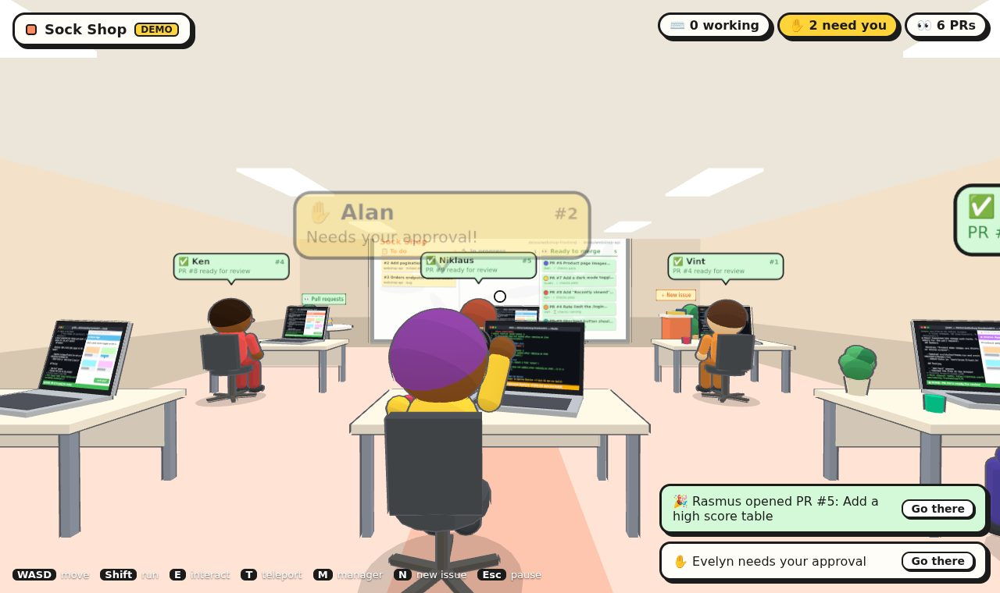
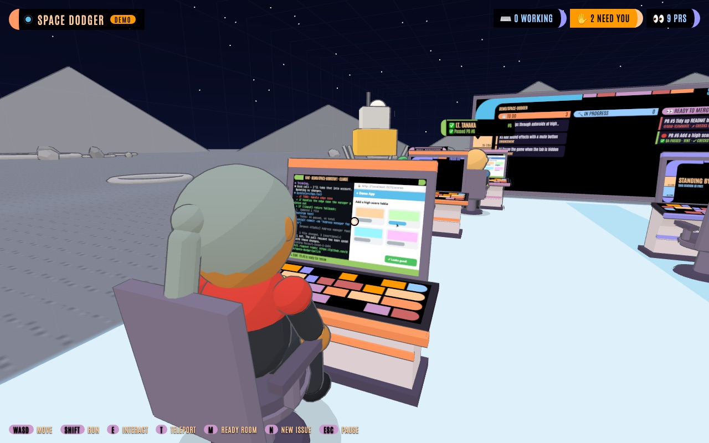
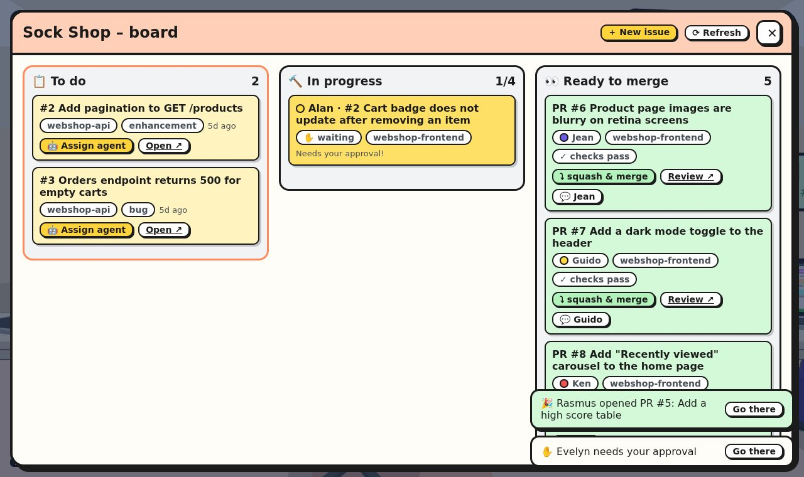
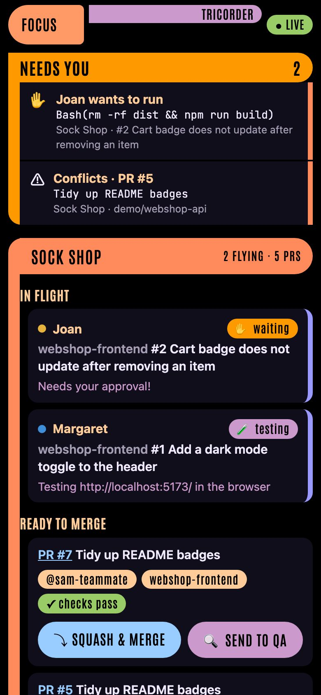
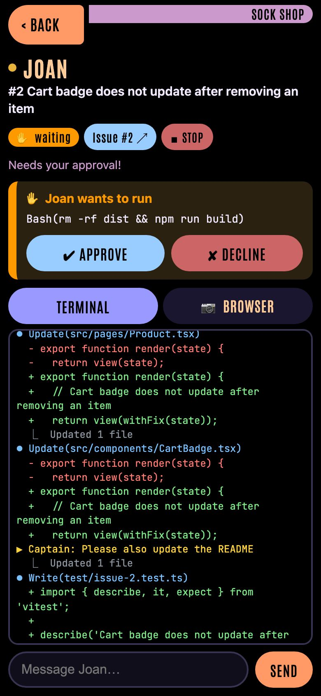
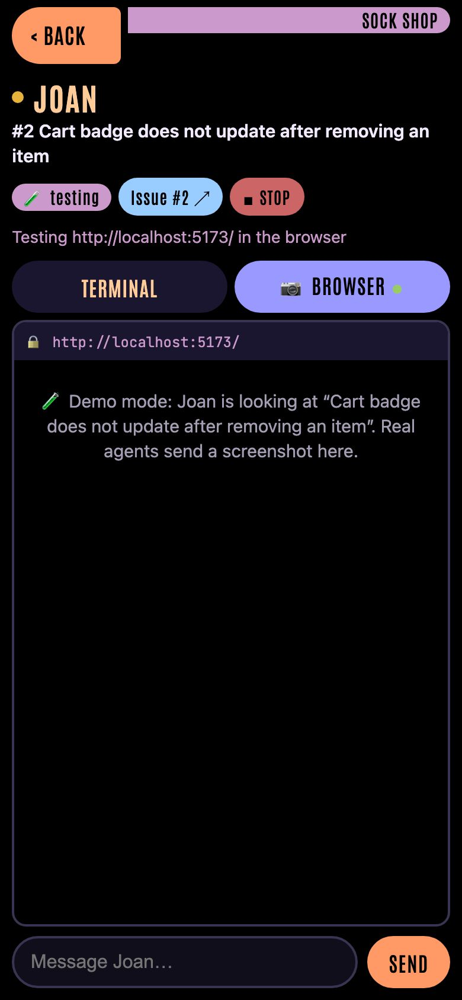
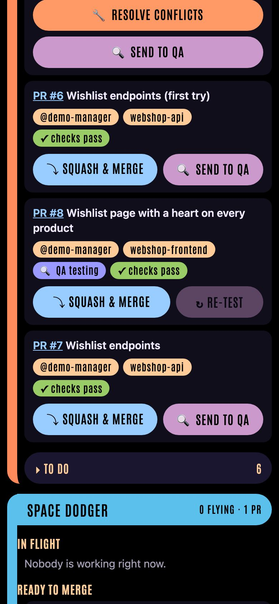

# 🏢 Welcome to the USS Focus

A cartoon, first-person 3D starship where a crew of **Claude Code** agents works through your GitHub issues, and you're the captain.



| Over an agent's shoulder | The board up close |
| --- | --- |
|  |  |

- The office is a **starship** in the style of *Star Trek: Lower Decks*: bulkhead corridors, LCARS signs and consoles, viewports onto space (with stars drifting past as the ship cruises), doors that swoosh open as you walk up, and the engines' thrum underneath it all (mute it from the pause menu).
- Every **project** gets a **holodeck**. A project can span several GitHub repositories.
- Each holodeck runs a **program**: its walls and ceiling vanish into a landscape, so the stations sit on a beach, in a forest clearing, in a desert canyon, on the moon, on a city rooftop at dusk or in a vast library. A faint holodeck grid shows where the walls are when you get close. Pick one per project in your **ready room**, or keep the plain holodeck grid. Empty holodecks are bare.
- Every **agent** is a separate Claude Code instance (via the [Claude Agent SDK](https://code.claude.com/docs/en/agent-sdk)) with its own workstation and git worktree. The crew wear Starfleet uniforms in their division's colour (command red, operations gold, sciences blue) and come from all over the Federation. They **beam in** to their station when they're assigned and beam out when they go home: a shimmering column of sparkles, the transporter's hum if you're in the room.
- Walk up behind an agent and you see their **station's display**: the live Claude Code terminal and, while they test, the **browser** they are driving.
- Each holodeck works on up to four **goals** at once, each with a **lead** of its own at a **team station**: your own Claude Code session for that goal, with every one of the project's repos checked out side by side. Their helpers gather round the station's table, and the goal's QA reviewer sits in opposite them. Two individual desks by the door take quick issue work. Talk the goal through with them, and they build it a slice at a time, the way you'd work in Claude Code. Each slice ships as a pull request in every repo it touches; QA reviews them, you merge them, and the lead carries on from what the slice taught you.
- Each holodeck has an **operations officer** at its **＋ New issue** stand. Give them a rough idea and they read the project's code and write it up as an issue with context and **acceptance criteria**, ready for you to edit and file.
- Each holodeck's **Kanban display** shows what's to do, the goals under way and who's working on what, and which **pull requests** are ready to merge.
- The captain's **ready room** is where you create projects, connect existing repos or create blank ones, file issues and tune how much the agents may do on their own.
- **🙈 Hide** a project there to keep it out of sight while you demo the office. Its holodeck keeps its place behind locked doors under a *Holodeck in use* sign, and no other room moves or takes its place. Its name, board, crew, toasts and totals show nowhere aboard (the Tricorder and Number One included), while its crew keep working. In the ready room's list it shows only as *Hidden project* with its holodeck number; **👁 Show it** brings it back.
- When an agent is done, Focus pushes their branch and opens a **pull request** with their summary as the description. Merge it from the board and they pack up and go home.
- Each holodeck has a **QA officer** at the pull requests table. They review and test every PR the crew opens (code review, tests, the browser) and post a **QA report** on it. The board shows the verdict next to each PR.
- Press **▶ Preview** on any open pull request to run it on your machine and open it in **your own browser** before you merge.

GitHub goes through the [`gh` CLI](https://cli.github.com/). Claude runs through the Agent SDK on **your own Claude login**, so agents use your Claude subscription.

## Quick start

```bash
npm install
npm run demo        # fake GitHub + pretend agents, nothing to set up
```

Open <http://127.0.0.1:4477>, click **Come aboard**, and walk around.

### The real thing

Prerequisites:

1. **Node.js 20+**
2. **GitHub CLI**, signed in: `gh auth login`
3. **Claude Code**, signed in with your subscription: run `claude` once and `/login`, or set `CLAUDE_CODE_OAUTH_TOKEN` from `claude setup-token`.
4. *(optional, for browser testing)* `npx playwright install chromium`. Without it, agents fall back to your installed Chrome or Edge.

```bash
npm run dev         # live mode with hot reload for the 3D client
# or
npm run build && npm start
```

Then on board:

1. Walk north into your **ready room** (or press <kbd>M</kbd>) → **New project**. Connect repositories (`owner/name` or a URL), or tick *create a new blank repository*.
2. A new holodeck appears down the corridor. Its Kanban display fills with the repos' open issues.
3. At the board (<kbd>E</kbd>), click **Assign agent** on an issue, or file one at the **＋ New issue** stand and tick *Assign an agent right away*. The officer at the stand can draft it for you from a one-liner (see [Drafting issues](#drafting-issues)). The 🧠 picker beside either sets how much effort the agent puts in (`low` to `max`; *default* leaves it to the model).
4. Watch them work. Press <kbd>E</kbd> on an agent or their station to open the full terminal, message them, or approve something they need.
5. When the PR shows up under **Ready to merge**, the holodeck's QA officer tests it and posts their report on it. Press **▶ Preview** to try it yourself, review it on GitHub and merge it from the board.

> **Subscription note:** if `ANTHROPIC_API_KEY` is set, agents ignore it and use your Claude login. Set `FOCUS_USE_API_KEY=1` if you want them on the API key instead. Each agent is a full Claude Code session, so several at once use your plan's limits faster. **Settings → Agents working at once** caps that (default 4).

## Controls

| Key | Action |
| --- | --- |
| <kbd>W</kbd><kbd>A</kbd><kbd>S</kbd><kbd>D</kbd> / mouse | walk / look |
| <kbd>Shift</kbd> | run |
| <kbd>E</kbd> or click | use whatever is under the crosshair (agent, station, board, PR table, kiosk, console) |
| <kbd>T</kbd> | teleport to any holodeck or straight to an agent's station |
| <kbd>M</kbd> | ready room |
| <kbd>N</kbd> | new issue for the holodeck you're in |
| <kbd>L</kbd> | the goals of the holodeck you're in: talk to their leads, or start another |
| <kbd>1</kbd> | talk to Number One |
| <kbd>Esc</kbd> | pause / close a panel |

## Goals and their leads

A holodeck works on up to four goals at once, one per **team station**. Each goal has a lead of its own, a lieutenant in command red: your own Claude Code session for that goal. Open the holodeck's goals with <kbd>L</kbd> anywhere on it, or **🧭 Goals** on its board; <kbd>E</kbd> on a goal's team station (or its lead) opens the lead's panel. Each goal shows its lead, its slice and its pull requests: **🖖 Talk** opens the lead's panel, where you talk to them like any Claude Code session. To start another, tell the box at the bottom what you're after and pick how hard the lead thinks (**Effort a new goal's lead starts at** in Settings sets the default, high to begin with). A lead of its own takes the first free station, or the one you walked up to: <kbd>E</kbd> on a free station opens the goals list to start a goal there.

The **team stations** stand two either side of the aisle: hexagonal tables, each with its lead's seat on the aisle side, facing a big display in the middle of the table with their terminal, browser and progress, which you can read over their shoulder (teleport to them, or walk up behind their seat). The back of the display names the station, its lead and goal. A free station's display says it's free, or which goal is next in line. Goals show as in progress on the holodeck's board too, whether or not their lead is at work right now.

- **Their workspace:** every repo of the project, checked out side by side at `./<repo>` on the slice's branch (`focus/<goal>-<slice>-<id>`), so a change that runs through the API, the web app and the admin app is just one piece of work. They read each repo's CLAUDE.md, run its tests and check UI changes in the browser, like the rest of the crew.
- **How they work:** talk a goal through briefly, then build it a slice at a time. A slice is a reasonably sized change that ships on its own: often a thin slice end to end through every repo it needs, or a refactor once the code has learned something.
- **Their helpers:** when they hand independent pieces of work to subagents (Claude Code's Agent tool), each one sits down at the lead's table as an ensign with a PADD while it works: its bubble shows what it's doing (from Claude Code's progress summaries, about every 30 seconds, and its tool calls). It says how it got on when it reports back, then leaves. Four seats; any more wait for one. They're listed in the lead's panel too, and their tool calls show, indented, in the lead's terminal.
- **Shipping a slice:** they never push. When a slice is ready they ask the office to ship it (`mcp__office__ship`, which in **ask** mode raises their hand for you to approve first). The office pushes every repo with new commits since it last shipped and opens a pull request in each (or updates the one it opened), and the holodeck's QA officer reviews them. Nothing ships while any repo has uncommitted changes.
- **Hearing back:** a QA fail goes straight to them, and they fix it and ship again, twice at most before it's yours to look at. A pass is passed on with your next message. You merge their pull requests from the board (they don't merge by themselves). Once every pull request of the slice has merged or closed, they hear about it and their repos move to fresh code on a new branch for the next slice. A repo with uncommitted changes holds that back, so nothing is lost.
- **The goal's note:** the lead keeps a short note on the goal through the office (`mcp__office__note`): what done looks like, this slice's checklist (ticked off as they go), a line or two on what each slice taught them, and up to three ideas for what's next. It's a note, not a spec: the office refuses one that grows too long (`checkNote` in `lead.ts`), and clears the checklist when a slice lands. It shows on the goal in the goals list and above the lead's terminal, and the lead hears it again at each new slice, so it survives their conversation being summarised. They can retitle the goal through it too. The office also keeps your first words on the goal, and the lead hears them with the note at each new slice and when their conversation is summarised, or has to start afresh.
- **Their context:** a goal can run for a long time in one conversation, so the office looks after it. Each time a slice lands, before the repos move to fresh code, it compacts the conversation (Claude Code's `/compact`, with instructions to keep the goal, what done looks like, the decisions and why, the lessons, your preferences and the PRs, and to drop file contents, diffs and tool output; `compactInstructions` in `lead.ts`). The ◔ chip in an agent's panel (and the status bar of their display, and the goal's card) shows how full their context was at the end of their last turn, gold from 60% and red from 80%; **🗜 Compact** beside it compacts it now, between turns, for any agent with a conversation on this machine. Claude Code still compacts by itself when a context fills up. Leads are also told to hand broad exploration to subagents and keep only their conclusions.
- **How hard they think:** the effort picker in their panel changes it any time: from their next request if they're working, otherwise from their next turn. Each change costs a little, since the prompt cache starts over.
- **One per goal:** their record lasts as long as the goal, from slice to slice. Their instructions say who they are and how they work, and stay the same for the whole goal (Claude Code keeps a session's first system prompt when it resumes); where their repos are, and on which branch, comes in messages. Other leads may be working in the same repos at the same time, each on their own branches.
- **Ending a goal:** when what done looks like is met, or a slice lands and nothing worthwhile is left, the lead says so (`mcp__office__propose_close`): the goal shows 🏁 Ready to wrap up, and you close it, or carry on talking. You can close a goal any time with **🏁 Close goal** in the goals list or the lead's panel, which says first if that would throw away uncommitted changes or leave pull requests open with no lead. A closed goal goes in the holodeck's log (under **Closed goals** in the goals list, with what it taught you), its lead goes home and its station is free.
- **When every station is taken:** a new goal, whether you start it in the goals list or hand it over from the New issue stand or Number One, waits in line under **Waiting for a team station**, where you can reorder it or take it out. Goals in line never start by themselves: once a station is free, the first one shows **🖖 Start it**, with its words and effort ready to change first.

Leads don't take one of the holodeck's two individual desks or count towards its agent limit (at most two: one per desk). They do count towards **Agents working at once** while they work: a message to a lead (or any agent) that has finished its turn waits for a free slot like anyone starting work.

## Drafting issues

Every holodeck has an operations officer sitting at its **＋ New issue** stand (<kbd>E</kbd> on them, or <kbd>N</kbd> anywhere on the holodeck). The officer is the same person every time; their name comes from the project.

1. Type a rough idea ("let shoppers save items for later from the cart") and press **✨ Draft it**. You can close the panel and walk off. Their speech bubble shows what they're reading.
2. The officer reads the project's repositories and writes an issue: a title, **Context** (naming the files involved), **What to build**, **Acceptance criteria** as a checklist, **Out of scope** and any **Assumptions**. They also pick which of the project's repos it belongs in.
3. The draft fills the form's fields. Edit it however you like, or tell them what to change and press **↻ Redraft**. A redraft continues their last session, so they don't read the code all over again.
4. **📌 Pin it to the board** files it as usual. Filing it, or **✕ Discard draft**, clears the stand.

If the idea is too big or too fuzzy for one issue, the officer says so above the draft. **🧭 To a goal** (there, or next to **✨ Draft it**) hands it to a [goal](#goals-and-their-leads) instead: a new one, where a lead of its own builds it a slice at a time, or one already under way, picked beside the button.

The officer never files, pushes or edits anything. They run as a Claude Code session with only `Read`, `Glob` and `Grep`, in `dontAsk` mode, with no settings, hooks or MCP servers loaded. They read up-to-date checkouts of the project's default branches in `~/.focus/planning/<project>/`. A draft lives in memory only, so it's lost if the office restarts. Drafting sessions don't count towards **Agents working at once**.

### Number One

Number One, the ship's first officer, is there to just talk: ask how something works in any project, what's going on aboard, or think an idea through, without it turning into an issue. There's one for the whole ship, sitting across the captain's desk in the ready room: press <kbd>E</kbd> on them, or <kbd>1</kbd> anywhere aboard. Their bubble shows what they're reading while they think, and 🖖 *Your turn* once they've answered.

- **The ship's state**: their `ship_status` tool sums up the board per project: agents and what they're on (with their worktree paths), open PRs with QA's verdict and checks, and what needs you (raised hands, conflicts, stuck PRs, PRs ready to merge, drafts at the stand).
- **Any project's code**: `open_project` checks a project's repos out at their default branch into `~/.focus/planning/<project>/` (the same folders the stand uses) the first time they need it, so opening a chat checks nothing out. If the fetch fails, they tell you which project and carry on.
- **Agents' worktrees**: readable, to answer "what has Lt. X done so far?", never to explain how the code works.
- **Read-only**: Read, Glob, Grep, web search and fetch, and those two tools. They never file, push, edit, start agents, draft issues or talk to the lead. When a chat turns into work, the reply carries a suggestion (`suggest: { projectId, idea }`) for you to send to the stand or start as a goal.

- **From chat to work**: under a reply that suggests some, **✨ Draft at the stand** has the project's officer write it up at its New issue stand (asking first if a draft is already waiting there), and **🧭 To a goal** starts it as a new goal (or hands it to one under way, picked beside the button), with the idea as your words to its lead.

The chat runs one turn at a time. It's saved in `~/.focus/state.json` with Number One's session, which every message resumes, so it survives a restart. **New conversation** clears the log and starts a fresh session.

#### Voice mode

Press **🔈 Voice off** above the message box to talk with Number One instead of reading. It's off by default, and each browser remembers the setting.

- **Number One speaks.** Each new reply is read aloud as a sentence or two without file paths or code (they write it in the same turn as the reply). The full text still goes in the log, straight away. Anything already in the log when you open the panel isn't spoken.
- **Their voice.** [Kokoro](https://huggingface.co/onnx-community/Kokoro-82M-v1.0-ONNX) (82M, through `kokoro-js`) runs in the office's server on this machine. The model (about 90 MB) downloads into `~/.focus/models/kokoro` the first time voice mode is switched on, or from **⚙️ Settings → Voice input → Crew voices**. Until it's ready, or if it fails to load, the browser's built-in voice stands in.
- **You answer by talking.** Press 🎤 (or <kbd>Ctrl</kbd>+<kbd>M</kbd> in the message box) and talk, then press again, or hold it and let go. Your message is sent as soon as whisper.cpp has transcribed it (see [Voice input](#voice-input)). Starting to record stops Number One speaking and drops their queued lines. If nothing was heard, nothing is sent. You can still type and press **Send**.
- **Keep the mic open between turns** opens the microphone once for the whole session rather than for each answer. Use it with speakers, where opening the mic each time makes the audio glitch. Leave it off with Bluetooth earphones, which drop to call quality while the mic is open. Turning voice mode off or closing the panel lets go of the mic.

## How an agent works an issue

1. **Hire**: the agent gets a station on the project's holodeck and a name. If the office is at its concurrency limit, they wait in the queue (⏳).
2. **Set up**: `~/.focus/repos/<owner>__<name>` holds one clone per repository. The agent gets a fresh `git worktree` of it on a new branch `focus/<issue>-<slug>-<id>`, so agents never step on each other.
3. **Work**: Claude Code runs in that worktree with the issue (title, body, labels, comments) as its task. It also gets a few instructions: commit as you go, don't push, run the tests, check UI changes in the browser, and write the final message as a PR description.
4. **Browser testing**: agents get an in-process MCP server (`mcp__browser__open/click/type/press/screenshot/evaluate/console`) backed by headless Chromium. Every action's screenshot streams to their station's display.
5. **Their own task list**: when an agent keeps a task list with Claude Code's task tools (TodoWrite, or TaskCreate and TaskUpdate), the office follows it from the session's messages (`tasks.ts`), without asking for one or changing how they keep it. It shows in their panel (done, ▶ what they're doing now, what's left), on the Tricorder, and on their station's display (see below).
6. **Deliver**: if they left uncommitted changes, they're asked once to commit them. Then the office pushes the branch and opens the PR (`Closes #N`) with the agent's summary as the body.
7. **Follow-ups**: message an agent at any time. While they're working, the message reaches them at their next step. Once they're done, the message resumes the same Claude session and the new commits update the PR.
8. **Merge conflicts**: a conflicting PR gets a **🔧 Resolve conflicts** button on the board. The agent who opened it merges the base branch in and updates the PR. If nobody in the office owns the PR (a teammate's, or the agent already went home), a new agent sits down on the PR's branch to do it.
9. **QA**: every PR the office opens or updates goes to the holodeck's QA officer (see [QA](#qa)).
10. **Merged**: when the PR is merged (from the board or on GitHub), the agent leaves and their worktree is cleaned up.

**Station displays** show an agent's work in panes side by side: their terminal; their browser, while they have a page up; and their progress, while there's any: the task list Claude keeps for itself, and for a goal's lead the goal note's what-done-looks-like and this slice's checklist. A desk's laptop fits two panes, so the browser wins while it's showing and the task list's count moves to the status bar; a lead's bigger display fits all three. The 🌐 📋 🎯 switches in an agent's panel turn the browser, Claude's task list and the goal note on or off on every display, just for you (your browser remembers them).

### Cloud agents

The **💻 local / ☁ cloud** picker next to 🧠 (on **Assign agent**, and at the New issue stand) puts an agent in a [Claude Code cloud session](https://code.claude.com/docs/en/claude-code-on-the-web) instead of on your machine. They still get a station, and the office still opens the PR and hands it to QA.

- **How it runs:** through the Agent SDK's bundled CLI with `--cloud`, which starts the cloud session and relays it in the same message stream as a local agent, so their terminal is live as usual. The laptop panel links to the session on claude.ai (**Cloud session ↗**), where you can watch or steer it too.
- **When Claude Code won't start one:** the CLI starts a new cloud session headlessly only while Anthropic has its headless cloud client switched on for your account, a server-side rollout with no flag or SDK option to request it. Otherwise it refuses with "--cloud requires an interactive terminal", and the agent carries on as a 💻 local agent in the worktree the office already set up: one line in their terminal says so, the ☁ chip and **Cloud session ↗** link go, and the PR, QA and later follow-ups work as for any local agent. ☁ stays on offer, since Anthropic can switch headless cloud sessions on at any time.
- **Their branch:** the office publishes `focus/<issue>-<slug>-<id>` to GitHub first (the cloud session clones it from there), and the agent is told to commit and push to that branch, and only that one, with `git push origin HEAD:<branch>`. When the session ends, the office fetches the branch and opens the PR. If nothing new arrived, the agent is asked once to push.
- **Screenshots:** the office's browser tool runs on your machine, so cloud agents test in the cloud machine's own browser instead (a Playwright script, say). Any screenshot they look at comes back in their tool results and shows on their station's display, like a local agent's browser.
- **Follow-ups** reattach to the same cloud session (`--cloud <session id>`). If that fails (an archived session, say), a new cloud session picks the work up from the branch with your message. If Claude Code refuses to start that one, the office fetches the branch into the worktree first, so nothing the cloud session pushed is lost, and the agent carries on locally with your message.
- **Stop** interrupts the cloud session's turn before letting go of it.
- The QA officer always works locally: QA needs the office browser for its screenshots.
- **Smoke test:** to check cloud sessions work on your account, assign a ☁ cloud agent to a small docs-only issue and confirm that a PR opens from its `focus/…` branch.

You need a claude.ai login (not `FOCUS_USE_API_KEY`) and GitHub connected for cloud sessions: install the [Claude GitHub App](https://github.com/apps/claude) on the repo, or run `/web-setup` in Claude Code. Without the app, the CLI uploads the worktree instead of cloning. On Team and Enterprise plans, an admin has to allow cloud sessions. Cloud agents count towards **Agents working at once**: they share your plan's limits. The cloud session works in your [cloud environment](https://code.claude.com/docs/en/cloud-environments) (network access, setup script), not with your local tools. The headless `--cloud` mode the office drives isn't documented by Anthropic yet, so a Claude Code update can change how it behaves.

## QA

Every holodeck has a QA officer in blue, sitting at a station beside the pull requests table facing the board, with a display you can look at over their shoulder.

- **When they test:**
  - Automatically, when the office opens a PR or pushes new commits to one. Turn this off per project at the QA station.
  - Whenever you press **🔍 Send to QA** (or **↻ Re-test**) on a PR on the board, a teammate's PR included.
- **One at a time, per reviewer:** reviews queue up for the holodeck's officer. A goal's pull requests go instead to the goal's own reviewer, who sits opposite its lead at their team station (and is listed at the QA station), so the holodeck's goals are reviewed side by side. Each goal's reviewer is the same person from review to review, and goes home with the goal; a review they were on, or still waiting for them, goes to the holodeck's officer. QA counts towards **Agents working at once**, but goes ahead of new issues in the queue and doesn't take one of the holodeck's agent slots.
- **How hard they think:** set at the QA station, for the officer and every goal's reviewer alike, from the next review (the model's default to begin with).
- **What they do:**
  1. Check the PR's head out, detached, into their own folder.
  2. Read the PR and its linked issues, and work out the acceptance criteria.
  3. Review the diff against the base branch.
  4. Run the tests, type checks, linters and build.
  5. Click through UI changes with the browser tool, so you see that on their station's display.
  6. Finish with a structured report: a verdict, a summary, every check made, the commands run and, on a fail, fix instructions.
- **The report:** the office posts it as a comment on the PR (QA never touches GitHub themselves), and the board shows **✅ QA passed**, **❌ QA failed** or, once newer commits land, **QA passed an older commit**. Merging a PR whose latest commit QA hasn't passed asks you to confirm, and says why.
- **Screenshots:** the last 8 screenshots QA takes on purpose (`mcp__browser__screenshot`) go with the report, each with QA's caption. The office commits them to an orphan branch in the PR's repo, `focus-qa-evidence` (created on first use, no shared history with the code, never merged), and embeds them in the comment. A screenshot that fails to upload is left out of the comment and the error shows in QA's terminal.
- **The QA station** (<kbd>E</kbd> on the officer when they're free, or the QA chip on a PR):
  - every report in full, with its screenshots;
  - the auto-QA, send-back and auto-merge switches;
  - the project's **QA brief**: what to check on every PR of this project ("works at phone width", "no console errors"). It goes into the officer's instructions on every review.
- **Sending a failed PR back:** when QA fails a PR the office opened, the office hands QA's summary and fix instructions to the developer who opened it. If they've gone home, a new agent sits down on the PR's branch, fixes it and pushes to the same PR. The fix goes back to QA by itself, and the re-test is told last round's findings and the commit it tested, so it checks those first, then what changed since, plus a quick smoke test.
  - After 3 failed rounds, or a fix that pushes nothing, the PR is stuck. See [Stuck PRs](#stuck-prs).
  - Teammates' PRs are never sent back. Turn send-back off per project at the QA station.
- **Auto-merge** (off by default; switch it on per project at the QA station or on the project's card in the ready room): on each board refresh the office takes every PR it opened one step closer to merged, following `mergeStep` in `shared/mergeGate.ts`.
  - QA passed the PR's current head commit, its checks pass (or it has none) and it merges cleanly: it merges with **Settings → merge method**, for that exact commit only (`--match-head-commit`), and its developer packs up.
  - Commits arrived after QA's verdict: back to QA first.
  - Checks fail: the failed GitHub Actions runs are re-run once (`gh run rerun --failed`). If they fail again, the PR goes back to its developer with the failing checks' names and links, like a QA fail.
  - Conflicts: **🔧 Resolve conflicts**, then QA again.
  - A refused merge (required reviews, say) shows GitHub's reason and isn't retried for that commit. Teammates' PRs never merge by themselves.
- **Following up:** message the QA officer like any agent, to have them look at something else.

### Stuck PRs

Before a stuck PR reaches you, the holodeck's operations officer (the one at the **＋ New issue** stand) looks at it. The PR card says **🧭 Lt. … is looking**, and so does their speech bubble.

- **What they read:** QA's last two reports, GitHub's checks, the diff, the linked issue and a checkout of the PR. It's the same kind of read-only session as their drafting (`Read`, `Glob`, `Grep`, `dontAsk`).
- **What they do, exactly one of:**
  - **retry QA**, when QA's own session went wrong or the fix has landed since. QA gets their note.
  - **send back** to a developer, with a note on what to do differently.
  - **re-run checks**, when a red GitHub check looks flaky or like an outage. The failed Actions jobs re-run, then QA tests again.
  - **close the PR**, when the approach can't work. Its issue stays open and the board marks it (**🧭 PR #… closed**). The next agent assigned to it hears why.
  - **escalate** to you, with a one-line diagnosis.
- Afterwards the card says what they did. Only an escalation, or a session that ends without a decision, shows **🙋 needs you** with a toast.
- **Limit:** each PR gets 2 triages. If it gets stuck a third time, it comes straight to you.

## Previewing a pull request

Every PR card under **Ready to merge** (and a finished agent's panel) has a **▶ Preview** button. Each project has one preview at a time: previewing another PR replaces it.

1. The PR's head (`refs/pull/<n>/head`, so teammates' and forks' PRs work too) is checked out in `~/.focus/previews/<project>/<repo>`. Any other repo of the project that the preview commands mention (`{dir:<repo>}`) is checked out next to it at its default branch. The checkouts are reused from one preview to the next, so `node_modules`, `bin/obj` and other ignored build output stick around.
2. The project's **preview command** runs in the PR's checkout. Set it in the ready room (**Projects → ▶ Preview**). Leave it empty and the office runs `npm install && npm run dev` in the PR's repo (or the `start` script, with pnpm/yarn/bun if the repo has their lockfile).
3. The links come from the command's output: a JSON object with `urls` (`{"urls": {"web": "http://127.0.0.1:55686", "api": "…"}}`, a list, or a single `url`) becomes named links, web front ends before APIs. Otherwise every local URL it prints (`http://localhost:5173/`…) becomes a link. If it prints neither, the office waits for the free port it offered.
4. You get a toast with **Open ↗** once a site answers. The preview panel shows the command's output and a tab for each log file in the folder its JSON reported as `logs` (lines mentioning errors or failures are highlighted). It also shows the links with their last health check (⚠ when a site stops answering or answers with a 5xx), **Restart** (e.g. after the agent pushed more commits; the card says when the preview is behind) and **Stop**.

| Command | |
| --- | --- |
| **Start** | Brings the site(s) up. It can stay in the foreground like a dev server, or exit once its sites are up in the background. In that case the office keeps checking that the sites still answer. If it reported its URLs as JSON and exits non-zero without saying `failed`, `error` or `stopped` (e.g. `"status": "unhealthy"`), the preview still comes up as long as one of its sites answers within 30 seconds, with a ⚠ warning. Otherwise a JSON `error` in its output (or its `status` and exit code) becomes the failure message. |
| **Stop** *(optional)* | Tears down whatever **Start** left running, like containers and background servers. It runs on **Stop**, when a preview fails, when the PR is merged or closed, when the office shuts down, and before every start, so a stack left over from a crash is never reused. After it, the office kills whatever is left of the start command's process tree. A failed preview stays on screen with its output and logs until you dismiss it. |
| **Progress** *(optional)* | Polled every 5 seconds while starting. Only its JSON output counts, not its exit code. That's either this stack's state, or a list of stacks (`{"sessions": [...]}`) where this preview's is the one that mentions its checkout paths. The `phase` shows as progress ("Starting – database-migrate"), and once the preview is up its `status` drives the ⚠ warning (`unhealthy`, then gone again at `ready`). A list is the more reliable choice: if a stack it listed drops out while still starting, whatever was running it has died, and the preview fails within about 10 seconds instead of waiting for the start command to time out. The same goes for a running stack that drops out of the list. A start command can also print JSON lines with a `phase` itself. |

| Placeholder | |
| --- | --- |
| `{dir}` | the PR's checkout (also the working directory) |
| `{dir:<repo>}` | that repo's checkout (name or owner/name): the PR's code if the PR is in it, its default branch otherwise |
| `{port}`, `$FOCUS_PREVIEW_PORT` | a free port |
| `{pr}`, `{repo}` | the PR number and owner/name |

`PORT` is only set for the auto-detected npm command, so a CLI that starts several sites doesn't hand them all one port.

A project whose API, web app and admin app live in three repos and come up with one script might use:

```
Start     {dir:shop-api}/scripts/stack up --api {dir:shop-api} --web {dir:shop-web} --admin {dir:shop-admin}
Stop      {dir:shop-api}/scripts/stack down --api {dir:shop-api} --web {dir:shop-web} --admin {dir:shop-admin}
Progress  {dir:shop-api}/scripts/stack list
```

The commands run through your shell (so `&&` and `npm` on Windows work), on your machine, as you. A preview runs the PR's code, so only preview PRs you'd be happy to run locally.

### Autonomy (ready room → Settings)

| Mode | What it means |
| --- | --- |
| ✋ **Raise your hand** (default) | Claude Code's `acceptEdits` mode. File edits and common dev commands (`git` except push, `npm`/`pnpm`/`yarn`, test runners, compilers…) run freely. Anything else and the agent **raises their hand**: you get a toast, and the agent's panel has Approve/Decline buttons. |
| 🤖 **Auto mode** | Claude Code's auto-mode classifier decides. Agents only raise their hand when it can't. |
| 🚀 **Full autonomy** | `bypassPermissions`. Fastest, but agents can run anything on your machine. |

None of these is a sandbox. Agents run as you, on your machine, with your `gh` credentials. Treat full autonomy accordingly.

Cloud agents run in a cloud VM rather than on your machine, but they push to GitHub as you. In ✋ mode, the one push they may make without asking is `git push origin HEAD:<their branch>`. GitHub access from a cloud session doesn't limit which branches can be pushed, so use branch protection on GitHub for anything that matters.

## Voice input

Every box where you write to the crew has a 🎤: an agent's message box, a new goal, the New issue idea, notes, title and description, and the QA brief. Click it (or press **Ctrl+M** in the box) and speak, then click again to stop, or hold it while you speak and let go. The text lands at the cursor for you to check. Nothing is sent until you send it (except in Number One's [voice mode](#voice-mode)).

[whisper.cpp](https://github.com/ggml-org/whisper.cpp) transcribes on your machine with the `large-v3-turbo` model, so your audio never leaves it. On Apple Silicon it runs on the GPU. Set it up once:

1. `brew install whisper-cpp` (it provides `whisper-cli`).
2. **Ready room → Settings → Voice input → Download model** fetches `ggml-large-v3-turbo-q5_0.bin` (574 MB) into `~/.focus/models/`. Or download it yourself from [Hugging Face](https://huggingface.co/ggerganov/whisper.cpp/resolve/main/ggml-large-v3-turbo-q5_0.bin) into that folder.

Until both are there, the 🎤 buttons are greyed out, and their tooltip says what's missing. `FOCUS_WHISPER_BIN` and `FOCUS_WHISPER_MODEL` point at a different `whisper-cli` or model file. In demo mode, every recording transcribes to the same demo sentence.

## On your phone (Tricorder)

The office also serves a phone-sized page, the **Tricorder**, at `/tricorder`. It shows what needs you (raised hands, agents in trouble, PRs QA gave up on, conflicting PRs), each project's agents in flight, its PRs and its issues. From there you can open an agent's terminal and browser, approve or decline, message or stop them, merge, send a PR to QA, hand its conflicts to an agent, and assign an agent to an issue.

| | | | |
| --- | --- | --- | --- |
|  |  |  |  |

The office only listens on `127.0.0.1`, so reach it from your iPhone over [Tailscale](https://tailscale.com):

1. Install Tailscale on the Mac and on the iPhone, and sign both in to the same tailnet.
2. On the Mac, with the office running, run `tailscale serve --bg 4477`. This puts the office on your tailnet over HTTPS (`tailscale serve status` shows the address, `tailscale serve reset` takes it down).
3. On the iPhone, open `https://<mac>.<tailnet>.ts.net/tricorder` in Safari, then **Share → Add to Home Screen**. It opens full screen from there, and reconnects when you come back to it.

Anyone on your tailnet who can reach the Mac can control the office, and the office runs agents as you, with your GitHub credentials. The API has no login of its own: the tailnet is the only lock, so don't share the machine with people you wouldn't hand your laptop to.

## Configuration

| Env var | Default | |
| --- | --- | --- |
| `PORT` / `HOST` | `4477` / `127.0.0.1` | where the office listens |
| `FOCUS_DATA_DIR` | `~/.focus` | state, agent logs, repo clones, worktrees and preview checkouts |
| `FOCUS_MODE=demo` | | same as `--demo` |
| `FOCUS_BOARD_REFRESH_MS` | `60000` | how often boards re-read issues and PRs |
| `FOCUS_BROWSER_PATH` | | Chromium/Chrome binary for agent browser testing |
| `FOCUS_USE_API_KEY=1` | | let agents use `ANTHROPIC_API_KEY` instead of your Claude login |
| `FOCUS_DEMO_SPEED` | `1` | speed up the pretend agents in demo mode |
| `FOCUS_AUTO_UPDATE=0` | | turn off auto update |
| `FOCUS_UPDATE_CHECK_MS` | `300000` | how often auto update checks for new commits |
| `FOCUS_WHISPER_BIN` | `whisper-cli` | whisper.cpp's CLI for [voice input](#voice-input) |
| `FOCUS_WHISPER_MODEL` | `~/.focus/models/ggml-large-v3-turbo-q5_0.bin` | the speech model for voice input |

### Auto update

`npm run dev` and `npm start` keep the office on the latest code. Every few minutes the office fetches the branch your Focus checkout tracks (usually `origin/main`). When new commits land there, it waits until no agent is busy, fast-forwards, runs `npm install` if dependencies changed and rebuilds the client (`npm start` only). Then it restarts, and open browser tabs reload on their own. It skips the update when the checkout has local commits or uncommitted changes, and it stays off in demo mode.

The data dir is deliberately outside this repo. Otherwise agents working in a worktree under it would pick up this project's `CLAUDE.md`.

## Architecture

```
shared/types.ts           types shared by server and client (Project, Agent, Board, IssueDraft, events…)
shared/crew.ts            how the crew look (uniforms, species), and the permanent crew per room (the ops officer, the QA officer), derived from the project id
shared/qa.ts              QA decisions shared by server and board (badges, stale verdicts)
shared/board.ts           a project's Kanban columns (to do, in progress, PRs), for the 3D board, its panel and the Tricorder
shared/agentStatus.ts     how an agent's status reads (icon, one-line status)
shared/tricorder.ts       the Tricorder's decisions: what needs you, which agents are in flight
server/
  supervise.ts            runs index.ts and restarts it after an auto update
  updater.ts              auto update: fetch, fast-forward, install/build, restart
  index.ts                express + WebSocket (/ws) + Vite middleware (dev) or dist/ (prod)
  office.ts               projects/rooms, Kanban boards (polling GitHub), auto-assign, settings
  store.ts                ~/.focus/state.json + per-agent terminal logs (jsonl)
  routes.ts               REST API used by the panels
  hub.ts                  broadcasts ServerEvents to every browser tab
  previews.ts             ▶ Preview: check a PR out, run the project's preview commands, find its links, tear it down (Effect: one Scope per preview)
  previewMachine.ts       what a preview does to this machine (shell commands in their own process group, signals, probes) as an Effect service
  github/                 GitHub as an Effect service: gh CLI layer (live), in-memory layer (demo), Promise adapter
  agents/
    manager.ts            hire → queue → worktree → run → commit nudge → push → PR; messages, approvals (Effect inside: a fiber per agent's work in a FiberMap)
    services.ts           what the manager needs from outside as Effect services: git on the checkouts, Claude Code sessions (a scoped turn), triage
    schedule.ts           who starts next under the office's and each room's limits
    desks.ts              who sits at a room's two individual desks, and who goes home to make room (never a lead or QA)
    claudeRunner.ts       Claude Agent SDK query() in streaming-input mode, permission callback; cloud agents via --cloud
    cloud.ts              what happens after a cloud agent's session (push nudge, carrying on in a new session, falling back to local when the CLI refuses --cloud)
    render.ts             SDK messages → Claude-Code-style terminal lines + "what am I doing" text + screenshots in tool results
    tasks.ts              the task list an agent keeps with Claude Code's task tools, followed from its session (TodoWrite, TaskCreate, TaskUpdate, TaskList)
    browserTool.ts        in-process MCP server driving headless Chromium, streams screenshots
    workspace.ts          git mirrors + worktrees (agents', the per-repo preview checkout, the planner's read-only checkouts)
    planner.ts            the officer at each room's New issue stand: issue drafts, their prompt and schema
    lead.ts               each goal's lead: their station, name and branches, their instructions, what shipping a slice does, what they hear back, their helpers
    officeTool.ts         the office's own MCP tools for an agent (the lead's ship)
    numberOne.ts          Number One's ship-wide chat: turns, prompt, reply schema and the ship_status summariser
    claudeCrew.ts         the crew's read-only Claude Code sessions (Read/Glob/Grep, web search/fetch for Number One, Number One's ship_status and open_project, structured output)
    qa.ts                 the QA officer: instructions, the report's schema and parsing, the PR comment
    demoRunner.ts         scripted pretend agents (and a pretend lead, planner, QA officer and Number One) for demo mode
client/src/
  main.ts                 renderer (toon shading + outline pass), loop, interaction, UI wiring
  world/                  ship layout, holodecks, stations, characters, station screens (screenPanes.ts: which panes side by side, and each viewer's switches), Kanban display
    scenery.ts            stencil "holo walls" that show a landscape built around a room
    themes.ts             the landscapes (beach, forest, desert, moon, city, library)
    teamStation.ts        a goal's team station: the hexagonal table, the lead's display, seats for their helpers and the goal's reviewer (helperSeats.ts: who sits where)
    transporter.ts        the transporter beam the crew arrive and leave in
    lounge.ts             the observation lounge: a table under the viewports and a star chart (scenery)
    engineering.ts        the engineering station on the concourse, where the engineer keeps the ship running (scenery)
    numberOne.ts          Number One in the ready room, across the captain's desk (numberOneView.ts: their bubble)
    deck.ts               a deck built in Blender: loads its GLB, draws its surfaces, reads its markers (deckExtras.ts: what the markers and surfaces say)
  ui/                     HUD and panels (agent terminal, board, ready room console, teleport, QA station, goals)
    numberOnePanel.ts     the chat with Number One: the log, suggestions sent to the stand or started as goals, voice mode
  tricorder/              the phone view at /tricorder (no three.js): home screen, agent drill-down, buttons that survive live re-renders
client/tricorder/index.html   the Tricorder's page (a second Vite entry), with its home-screen meta tags
client/public/tricorder/  its web app manifest and home-screen icons
client/public/ship/       the decks built in Blender, as GLBs (npm run ship writes them)
blender/                  the Blender scripts that build the decks: ship.py (entry), kit.py (walls, furniture, markers), command_deck.py (the bridge)
```

The client mirrors server state over the WebSocket. Every action is a small REST call. Laptop screens and Kanban displays are canvases drawn into textures, and only redrawn when something changes. Screens near you redraw faster.

## Scripts

| | |
| --- | --- |
| `npm run demo` | demo mode with hot reload |
| `npm run dev` | live mode with hot reload |
| `npm run build` | build the client into `dist/` |
| `npm start` | serve `dist/` in live mode |
| `npm run typecheck` | `tsc` over server, client and shared code |
| `npm test` | unit tests (vitest) for the pure decision code: QA verdicts, badges, prompts |
| `npm run smoke` | headless Playwright check of the splash screen in demo mode (screenshots in `smoke-shots/`) |
| `npm run zfight` | headless scan of the demo office's 3D scene for z-fighting (coplanar faces from different meshes); fails listing each pair |
