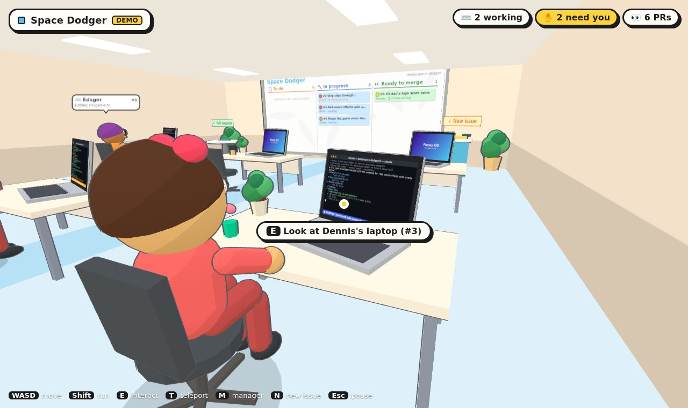

# 🏢 Focus HQ

A cartoon, first-person 3D office where a swarm of **Claude Code** agents works through your GitHub issues.


| Over an agent's shoulder | The board up close |
| --- | --- |
|  |  |

- Every **project** gets a **room**. A project can span several GitHub repositories.
- Each room has **scenery**: its walls and ceiling vanish into a landscape, so the desks sit on a beach, in a forest clearing, in a desert canyon, on the moon, on a city rooftop at dusk or in a vast library. A faint holodeck grid shows where the walls are when you get close. Pick one per project in the Manager's office, or keep plain office walls. Empty rooms are bare holodecks.
- Every **agent** is a separate Claude Code instance (via the [Claude Agent SDK](https://code.claude.com/docs/en/agent-sdk)) with its own desk, laptop and git worktree.
- Walk up behind an agent and you see their **laptop screen**: the live Claude Code terminal and, while they test, the **browser** they are driving.
- Each room's **Kanban whiteboard** shows what's to do, who's working on what, and which **pull requests** are ready to merge.
- The **manager's office** is where you create projects, connect existing repos or create blank ones, file issues and tune how much the agents may do on their own.
- When an agent is done, the office pushes their branch and opens a **pull request** with their summary as the description. Merge it from the board and they pack up and go home.

GitHub goes through the [`gh` CLI](https://cli.github.com/). Claude runs through the Agent SDK on **your own Claude login**, so agents use your Claude subscription.

## Quick start

```bash
npm install
npm run demo        # fake GitHub + pretend agents, nothing to set up
```

Open <http://127.0.0.1:4477>, click **Enter the office**, and walk around.

### The real thing

Prerequisites:

1. **Node.js 20+**
2. **GitHub CLI**, signed in: `gh auth login`
3. **Claude Code**, signed in with your subscription: run `claude` once and `/login`, or set `CLAUDE_CODE_OAUTH_TOKEN` from `claude setup-token`.
4. *(optional, for browser testing)* `npx playwright install chromium`. Without it, agents fall back to your installed Chrome or Edge.

```bash
npm run dev         # live mode with hot reload for the 3D client
# or
npm run build && npm start
```

Then in the office:

1. Walk north into the **Manager's office** (or press <kbd>M</kbd>) → **New project**. Connect repositories (`owner/name` or a URL), or tick *create a new blank repository*.
2. A new room appears down the hallway. Its whiteboard fills with the repos' open issues.
3. At the board (<kbd>E</kbd>), click **Assign agent** on an issue, or file one at the **＋ New issue** stand and tick *Assign an agent right away*.
4. Watch them work. Press <kbd>E</kbd> on an agent or laptop to open the full terminal, message them, or approve something they need.
5. When the PR shows up under **Ready to merge**, review it on GitHub and merge it from the board.

> **Subscription note:** if `ANTHROPIC_API_KEY` is set, agents ignore it and use your Claude login. Set `FOCUS_USE_API_KEY=1` if you want them on the API key instead. Each agent is a full Claude Code session, so several at once use your plan's limits faster. **Settings → Agents working at once** caps that (default 4).

## Controls

| Key | Action |
| --- | --- |
| <kbd>W</kbd><kbd>A</kbd><kbd>S</kbd><kbd>D</kbd> / mouse | walk / look |
| <kbd>Shift</kbd> | run |
| <kbd>E</kbd> or click | use whatever is under the crosshair (agent, laptop, board, PR table, kiosk, console) |
| <kbd>T</kbd> | teleport to any room or straight to an agent's desk |
| <kbd>M</kbd> | manager's console |
| <kbd>N</kbd> | new issue for the room you're in |
| <kbd>Esc</kbd> | pause / close a panel |

## How an agent works an issue

1. **Hire**: the agent gets a desk in the project's room and a name. If the office is at its concurrency limit, they wait in the queue (⏳).
2. **Set up**: `~/.focus/repos/<owner>__<name>` holds one clone per repository. The agent gets a fresh `git worktree` of it on a new branch `focus/<issue>-<slug>-<id>`, so agents never step on each other.
3. **Work**: Claude Code runs in that worktree with the issue (title, body, labels, comments) as its task. It also gets a few instructions: commit as you go, don't push, run the tests, check UI changes in the browser, and write the final message as a PR description.
4. **Browser testing**: agents get an in-process MCP server (`mcp__browser__open/click/type/press/screenshot/evaluate/console`) backed by headless Chromium. Every action's screenshot streams to their laptop screen.
5. **Deliver**: if they left uncommitted changes, they're asked once to commit them. Then the office pushes the branch and opens the PR (`Closes #N`) with the agent's summary as the body.
6. **Follow-ups**: message an agent at any time. While they're working, the message reaches them at their next step. Once they're done, the message resumes the same Claude session and the new commits update the PR.
7. **Merge conflicts**: a conflicting PR gets a **🔧 Resolve conflicts** button on the board. The agent who opened it merges the base branch in and updates the PR. If nobody in the office owns the PR (a teammate's, or the agent already went home), a new agent sits down on the PR's branch to do it.
8. **Merged**: when the PR is merged (from the board or on GitHub), the agent leaves and their worktree is cleaned up.

### Autonomy (Manager's office → Settings)

| Mode | What it means |
| --- | --- |
| ✋ **Raise your hand** (default) | Claude Code's `acceptEdits` mode. File edits and common dev commands (`git` except push, `npm`/`pnpm`/`yarn`, test runners, compilers…) run freely. Anything else and the agent **raises their hand**: you get a toast, and the agent's panel has Approve/Decline buttons. |
| 🤖 **Auto mode** | Claude Code's auto-mode classifier decides. Agents only raise their hand when it can't. |
| 🚀 **Full autonomy** | `bypassPermissions`. Fastest, but agents can run anything on your machine. |

None of these is a sandbox. Agents run as you, on your machine, with your `gh` credentials. Treat full autonomy accordingly.

## Configuration

| Env var | Default | |
| --- | --- | --- |
| `PORT` / `HOST` | `4477` / `127.0.0.1` | where the office listens |
| `FOCUS_DATA_DIR` | `~/.focus` | state, agent logs, repo clones and worktrees |
| `FOCUS_MODE=demo` | | same as `--demo` |
| `FOCUS_BOARD_REFRESH_MS` | `60000` | how often boards re-read issues and PRs |
| `FOCUS_BROWSER_PATH` | | Chromium/Chrome binary for agent browser testing |
| `FOCUS_USE_API_KEY=1` | | let agents use `ANTHROPIC_API_KEY` instead of your Claude login |
| `FOCUS_DEMO_SPEED` | `1` | speed up the pretend agents in demo mode |

The data dir is deliberately outside this repo. Otherwise agents working in a worktree under it would pick up this project's `CLAUDE.md`.

## Architecture

```
shared/types.ts           types shared by server and client (Project, Agent, Board, events…)
server/
  index.ts                express + WebSocket (/ws) + Vite middleware (dev) or dist/ (prod)
  office.ts               projects/rooms, Kanban boards (polling GitHub), auto-assign, settings
  store.ts                ~/.focus/state.json + per-agent terminal logs (jsonl)
  routes.ts               REST API used by the panels
  hub.ts                  broadcasts ServerEvents to every browser tab
  github/                 GitHubProvider: gh CLI (live) and an in-memory fake (demo)
  agents/
    manager.ts            hire → queue → worktree → run → commit nudge → push → PR; messages, approvals
    claudeRunner.ts       Claude Agent SDK query() in streaming-input mode, permission callback
    render.ts             SDK messages → Claude-Code-style terminal lines + "what am I doing" text
    browserTool.ts        in-process MCP server driving headless Chromium, streams screenshots
    workspace.ts          git mirrors + worktrees
    demoRunner.ts         scripted pretend agents for demo mode
client/src/
  main.ts                 renderer (toon shading + outline pass), loop, interaction, UI wiring
  world/                  office layout, rooms, desks, characters, laptop screens, whiteboard
    scenery.ts            stencil "holo walls" that show a landscape built around a room
    themes.ts             the landscapes (beach, forest, desert, moon, city, library)
  ui/                     HUD and panels (agent terminal, board, manager console, teleport)
```

The client mirrors server state over the WebSocket. Every action is a small REST call. Laptop screens and whiteboards are canvases drawn into textures, and only redrawn when something changes. Screens near you redraw faster.

## Scripts

| | |
| --- | --- |
| `npm run demo` | demo mode with hot reload |
| `npm run dev` | live mode with hot reload |
| `npm run build` | build the client into `dist/` |
| `npm start` | serve `dist/` in live mode |
| `npm run typecheck` | `tsc` over server, client and shared code |
