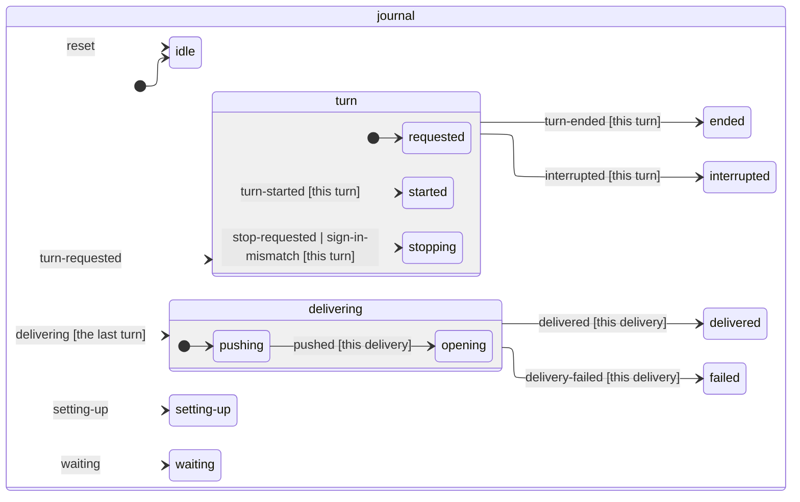
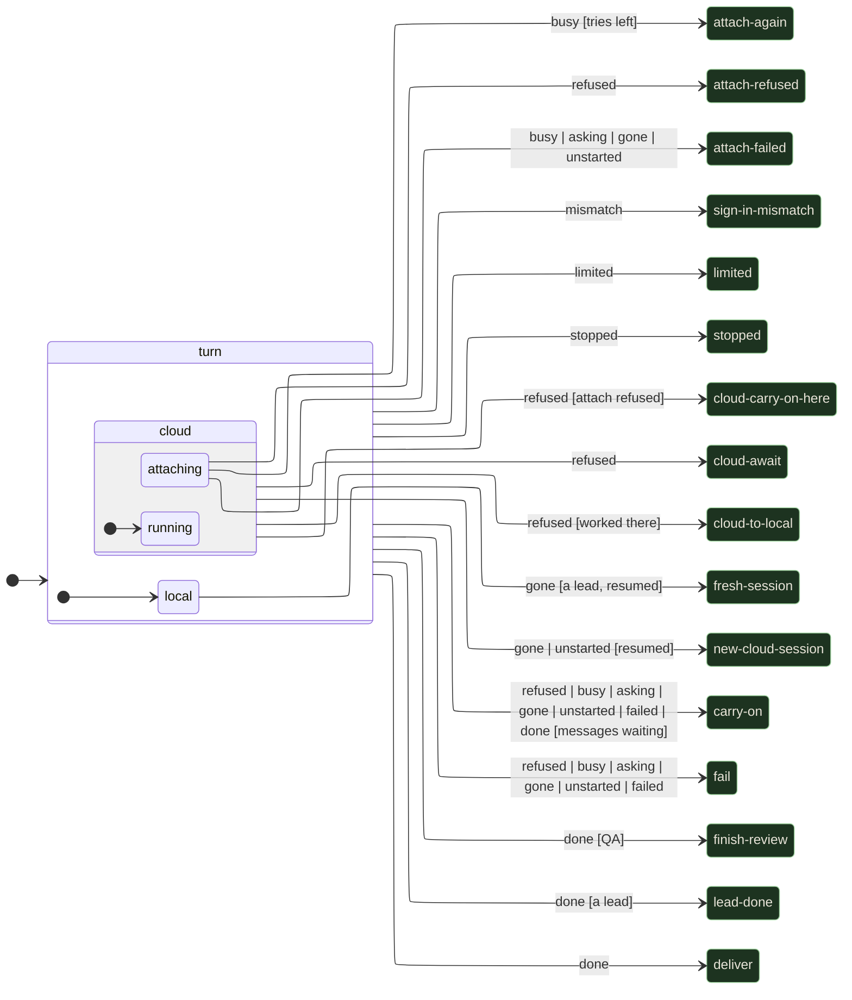

# How an agent works an issue

1. **Hire**: the agent gets a station on the project's holodeck and a name like the rest of the crew's, their rank and a surname (`Ensign Okafor`) that no other agent in the office, nor the room's ops or QA officer, has (`hiredName` in `shared/crew.ts`). If the office is at its concurrency limit, they wait in the queue (⏳).
2. **Set up**: `~/.focus/repos/<owner>__<name>` holds one clone per repository. The agent gets a fresh `git worktree` of it on a new branch `focus/<issue>-<slug>-<id>`, so agents never step on each other. The clone's local base branch (`main`) is brought up to GitHub's whenever the office fetches for an agent (a new worktree, a lead's repo moving to a fresh branch, a closed goal reopened, QA's checkout of a pull request: `followOrigin` in `server/agents/workspace.ts`), so `git diff main...HEAD` shows only the branch's own commits; the clone's own checkout lets go of the branch so git can move it, and it's only ever a fast-forward, never while someone's worktree has it checked out. Before the agent's first turn the office installs the dependencies there (`installDependencies` in `server/agents/workspace.ts`), from the lockfile with the package manager it names (`server/packageManager.ts`), at the root and in each folder directly inside it with a lockfile of its own (`e2e/`); a folder with a package.json but no lockfile is left alone, so no lockfile gets written into the checkout. It does the same in each repo of a lead's workspace, when a lead's repo moves to a fresh branch, when a closed goal's repos are checked out again, and in QA's checkout of a pull request (cloud agents install in their own clone). Each install leaves a stamp in `node_modules/.focus-install`, a hash of the package.json and lockfiles, so a folder whose files haven't changed since (a re-test of the same PR) isn't installed again, and deleting `node_modules` forgets it. An install that fails doesn't stop the agent: they hear which folder, the command and why with their task (or after the turn they're in), not from their first failing check.
3. **Work**: Claude Code runs in that worktree with the issue (title, body, labels, comments) as its task. It also gets a few instructions: commit as you go, don't push, run the tests, check UI changes in the browser, put throwaway files in the scratch dir, and write the final message as a PR description.
4. **Browser testing**: agents get an in-process MCP server (`mcp__browser__open/click/type/press/screenshot/evaluate/console`) backed by headless Chromium. Every action's screenshot streams to their station's display. `evaluate` returns a single expression as is (`await` allowed) and runs anything else as the body of an async function, returning the last statement's value when it's an expression (`a(); 'ok'` gives `'ok'`) or whatever it `return`s, and gives up after 30 s; its description lists the office page's `window.focusHQ` hooks, so agents working on Focus itself don't have to guess them. A failed `evaluate` says how to recover (`evaluateHint` in `server/agents/browserTool.ts`): run it again once the page has loaded when a navigation or Vite reload cut it off, reach a module's import (`THREE`) through an object already on the page rather than as a global, and, when the code reached for something that isn't there, what each of `window.focusHQ`'s hooks has right now, read from the page itself (`focusHQShape`). Every failed browser call ends with how busy the machine was (`machineLoad`): its 1-minute load average and CPU count, and whether more work was waiting than it has CPUs, so a timeout under load can be told from a page that never answered, by the agent and by the [retro](../plugins/retro/README.md) reading the transcript (not on Windows, which has no load average).
5. **Their own task list**: when an agent keeps a task list with Claude Code's task tools (TodoWrite, or TaskCreate and TaskUpdate), the office follows it from the session's messages (`tasks.ts`), without asking for one or changing how they keep it. It shows under **Tasks** in their panel (a green lamp for done, gold for what they're doing now), on the Tricorder, and on their station's display (see below).
6. **Deliver**: if they left uncommitted changes, they're asked once to commit them. Then the office pushes the branch and opens the PR (`Closes #N`) with the agent's summary as the body. Before the (forced, with lease) push it fetches with `--prune`, so a branch GitHub deleted after an earlier squash merge can't leave a stale ref that makes git refuse. When GitHub answers the push or the PR with a 5xx, it tries again after 4, 8 and 16 seconds, saying so in the agent's terminal, before giving up.
7. **Follow-ups**: message an agent at any time. While they're working, the message reaches them at their next step. Once they're done, the message resumes the same Claude session and the new commits update the PR.
8. **Merge conflicts**: a conflicting PR gets a **Resolve conflicts** button on the board (auto-merge presses it too). The office first merges the base branch in itself, in a scratch worktree (`mergeBase` in `server/agents/workspace.ts`), and pushes the merge when git needs no help, or when every conflicted file has a rule in the repo's `.gitattributes`: `focus-merge=union` keeps both sides' lines (append-only docs), `focus-merge=theirs` takes the base branch's version and `focus-merge=ours` the PR's (generated files: this repo takes main's baked GLBs, so a PR that changes `blender/` itself needs its decks built again, `pnpm run ship` or the Ship workflow by hand). Files with git's own `merge=union`, like this repo's `CLAUDE.md`, rarely conflict at all, in the office's merges or anyone's. Before pushing, it runs the project's `typecheck` script on the merge, if it has one, in the repo's checks folder (installed and run with the package manager its lockfile names, `server/packageManager.ts`: `pnpm install --frozen-lockfile` for a `pnpm-lock.yaml`, likewise yarn and bun, `npm ci` for a `package-lock.json`): a merge git makes cleanly can still break the tree, and one that does goes to an agent like a conflict. The ledger logs which files conflicted, and whether the office merged it (`office`), settled it by rule (`auto`) or an agent had to (`agent`, with the check that broke, if that's why). A PR QA had a verdict on goes back to QA at the office's merge (`verdictCatchesUp` in `server/agents/manager/conflicts.ts`): a clean merge on top of a pass keeps the pass once the project's checks are green, with no full re-test, so the board doesn't show **QA passed an older commit** while it waits for you. Otherwise the agent who opened it merges the base branch in and updates the PR. If nobody in the office owns the PR (a teammate's, or the agent already went home), a new agent sits down on the PR's branch to do it. That new agent works on the model and effort set under **Model and effort for resolving merge conflicts** in the manager's Settings tab (conflicts are usually mechanical, so a cheaper model often does): an empty model means the office's **Model**, and "default effort" the model's own. They're stamped on the agent when it sits down, so it keeps them if its session is resumed after the settings change. The PR's owner resolves conflicts in their own session, on whatever model and effort they already had.
9. **QA**: every PR the office opens or updates goes to the holodeck's QA officer (see [QA](qa.md)).
10. **Merged**: when the PR is merged (from the board or on GitHub), the agent leaves and their worktree is cleaned up.

**An agent's panel** (<kbd>E</kbd> on them or their station) has their terminal on the left (Claude's replies rendered from markdown, with headings, lists, tables and code; so are a helper's transcript and the Tricorder's terminal, while the station displays draw them as plain text without the marks) and, on the right, whichever view its sidebar has picked: their **Browser**, Claude's **Tasks**, and for a goal's lead the **Goal** (what done looks like, this slice, what we learned, what's next, and its pull requests) and the **Crew** of helpers. Each button carries a readout (LIVE, 1/3) and is dimmed while there's nothing to see. It starts on the browser if one's up, otherwise on the first view with something in it; once you pick one it stays put.

**Station displays** show an agent's work in panes side by side: their terminal; their browser, while they have a page up; and their progress, while there's any: the task list Claude keeps for itself. A goal's lead's note isn't on their display: it's on the goal board beside it (see [goals](goals.md)), so the viewscreen keeps to the work going on now. A desk's laptop fits two panes, so the browser wins while it's showing and the task list's count moves to the status bar; a lead's viewscreen in their briefing room (6 m across, nearly wall to wall) fits four, so what the lead has shown or asked and their browser stand side by side between the terminal and the progress pane (on a narrower screen the two share a column, what they've shown over the browser). Each pane of a briefing room's viewscreen opens up close on its own (aim at it and press E, from anywhere in the room): what the lead has shown or asked, their browser, their tasks, or their session; with nobody there, the screen is the station's, as its door is. To choose what the screens show, use the **Panes** strip of switches on the dado under the viewscreen, to starboard (the station's sign is its counterpart to port), at any station, with a lead or free: aim at a switch and press E to turn the lead's artifacts, the browser or Claude's task list on or off on every display (the terminal always shows), just for you (your browser remembers them, and every station's strip shows the same).

## The run journal: where a run was, and picking up after a restart

Each agent keeps a run journal, `~/.focus/runs/<agent id>.jsonl` (`server/agents/runJournal.ts`). Every line is a numbered fact about their turns and their inbox, appended and flushed to disk (fsync) *before* the office acts on it (`Store.journal`), and never rewritten. What the journal adds up to (`fold`) is the truth about the run's turns and messages:

- **Messages**: a message for an agent is `queued` as it arrives (heard next, in front, or once the turn in hand ends), `taken` into a turn's prompt or `sent` into a session that's listening (`server/agents/inbox.ts`). One taken for a prompt is still owed until its turn is asked for.
- **Turns**: `turn-requested` (its prompt, and the conversation it goes back to) is written before Claude Code starts, then `signed-in` (your plan or your API key), `turn-started` (the session, and where Claude Code says its credential came from: its `apiKeySource`), and `turn-ended` with how it ended. Claude Code's own transcript holds what happened inside the turn; the journal holds what the office decided around it.
- **The run's phase.** What the journal adds up to is a state machine's too (`journalMachine` in `runJournal.ts`, XState): each fact is an event and the run's phase is its state, so a run is rebuilt by replaying its journal through it (`fold`). A run is `idle`, `waiting` for a free slot, `setting-up`, in a `turn` (`requested` until Claude Code has it, `started`, `stopping` once the captain or a sign-in mismatch stopped it), `ended` (with what followed it, `decided` by the run machine below), `interrupted`, or for a developer's work going onto GitHub, `delivering` (`pushing`, then `opening` the pull request) until it's `delivered` or `failed`. Each delivery step is a fact keyed by the turn whose work it is (`delivering` with the pull request's description, `pushed`, `delivered`, `delivery-failed`), written by `Delivery` as it goes. The inbox's facts change what it holds in any phase. The agent's panel shows it as **Run** (`turn 3 running`, `turn 3 opening the PR`, `turn 3 delivered → PR #412`), with the journal's last fact number on hover.

<!-- journal-machine:start -->

<!-- journal-machine:end -->

- **What follows a turn** is the run's state machine, in XState (`server/agents/runMachine.ts`). The turn ended in a state (where it ran: `local`, `cloud`, or `attaching` to a cloud session the captain started), and its end is an event read once from its outcome (`done`, `failed`, `stopped`, `limited`, `mismatch`, `refused`, or why it never got going: `busy`, `asking`, `gone`, `unstarted`). `runMachine` holds each state's guarded transitions, and `step` takes one with XState's pure `transition`; an event a state has no transition for (or none whose guard passes) goes up to its parent, and `turn`, at the top, has a way out of every event. The target (deliver, the captain's turn, carry on, the plan's limit, stopped, failed, the cloud's fallbacks) is what the manager does next.

The machine, drawn from its code (`mermaidStatechart` in `server/agents/statechart.ts`; a test keeps this picture in step with `runMachine`):

<!-- run-machine:start -->

<!-- run-machine:end -->

**Signing in.** If Claude Code says it signed a turn in with `ANTHROPIC_API_KEY` or an `apiKeyHelper` when the office meant your plan's login (an `env` or `apiKeyHelper` in `~/.claude/settings.json` can do that behind the office's back), the turn is stopped at once (`sign-in-mismatch`) and the agent fails saying where to look, before it spends any more.

**After a restart** (`AgentManager.recover`, once the office has started), whether Focus crashed or shut down on purpose (Ctrl-C, an auto-update: `shutDown` stops every session but leaves their turns open in the journal): messages that were waiting are still waiting, and those taken for a turn that was never asked for go back in front. A turn the journal says was in flight is `interrupted`, and:

- a developer's work the journal says was going onto GitHub (`delivering`) is finished by the office: pushed again and its pull request found or opened, with no Claude turn and no nudge to commit (both steps are safe to repeat);
- an agent whose journal says they were `waiting` for a free slot is back in line (held for a message instead if going back to their conversation would be on your API key);
- a developer's, a fixer's, a conflict resolver's, a brief's or a lead's turn carries on by itself in the same conversation, told it was cut off (with any messages sent into it, in case they never arrived), or asked again if Claude Code never got it, as long as it would be on your plan;
- on your API key, QA's review, a cloud agent's, a compaction's, one the captain had just stopped (`stop-requested`), or with no conversation of its own to go back to, the agent waits for a message, saying why.

An agent sent home has a `reset` in their journal, so an id that comes back (a reopened goal, QA's next review) starts from nothing.

## Scratch dirs

Every local session (developers, QA, leads and their helpers) gets a scratch dir for throwaway files, `$TMPDIR/focus-scratch/<agent id>`, exported to it as `FOCUS_SCRATCH` (`server/agents/scratch.ts`). The office empties it when a run starts and deletes it when the run ends (for a lead, at the end of each turn), so their prompts tell them to put probe scripts, scratch repos and test output there and never clean up after themselves. Cloud agents work on a machine of their own and don't get one.

Every local session also gets the office's `bin/` first on its PATH (`server/agents/wait.ts`), with `focus-wait` in it: `focus-wait --until '<check>' --timeout 120 [--every 2]` runs the check in `sh` every couple of seconds, returns as soon as it passes (printing its output), and fails with its last output when time runs out. Claude Code refuses a foreground `sleep N; <check>`, which agents kept writing to wait for a demo, a build or a log, and its refusal left them guessing another way to wait; their prompts now name `focus-wait` instead. Cloud agents don't get it.

And every local session's Bash tool runs in bash (`/bin/bash`, through Claude Code's `CLAUDE_CODE_SHELL`; `server/agents/agentShell.ts`), not the captain's own shell. On a Mac that's zsh, where a glob that matches nothing, like `grep -rn x --include=*.ts` or `ls server/**/*.test.ts`, is an error that skips the command ("no matches found"): in about 50 sessions over two weeks a call failed that way, the commonest cause of the ledger's `bash exit code 1`. bash passes the word on as it is. A `CLAUDE_CODE_SHELL` the captain set themselves is kept, and Windows is left to Claude Code (Git Bash). Cloud agents keep their machine's shell.

If you use [dcg](https://github.com/Dicklesworthstone/destructive_command_guard) (the destructive command guard) as a `PreToolUse` hook, it blocks `rm -rf` outside the temp dirs, so agents used to leave their scratch behind or lose a chained command along with it. The office lays its own dcg config over yours and the project's, `~/.focus/dcg.toml`, through `DCG_CONFIG` in each session's environment (unless you set `DCG_CONFIG` yourself: then the office leaves it alone and agents can't `rm -rf` in scratch). It does two things:

- It allows `rm` of paths written as `$FOCUS_SCRATCH/…` (or `${FOCUS_SCRATCH}/…`), when that's the whole command: no globs, `~`, `$(…)` or other variables, and nothing chained before or after. `rm -rf` anywhere else is blocked as before. dcg only matches the text, so the office's own `PreToolUse` hook checks where each path really goes and refuses it if it has a `..` in it or a symlink in it leads out of the scratch dir, or if it's the dir itself.
- `git checkout -- <file>` and `git restore <file>` stay blocked, but the refusal names a safe way to undo a file instead of dcg's `git stash` (whose stack every worktree of a repo shares): save the diff in scratch and reverse it with `git apply -R`, or ask the lead. Each of these is narrower than a rule in dcg's core pack, so only the message changes, never what's blocked.
