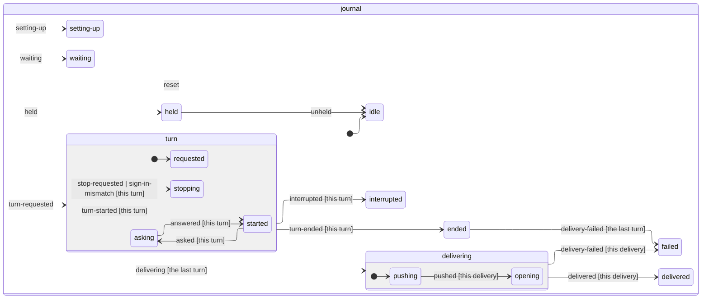
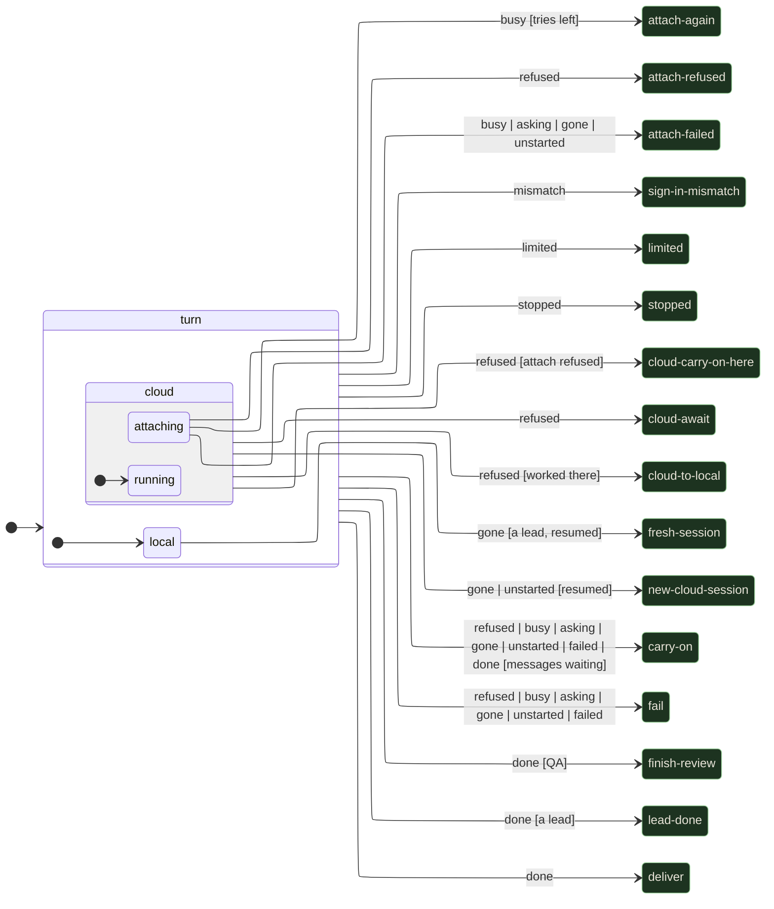

# How an agent works an issue

1. **Hire**: each agent gets a name no other agent aboard, nor the room's ops or QA officer, has. If Focus is at its concurrency limit, they wait in the queue.
2. **Set up**: one clone per repository, and each agent a fresh `git worktree` of it on a branch of their own, so agents never step on each other. The clone's local base branch is brought up to GitHub's whenever Ops fetches for an agent, so `git diff main...HEAD` shows only the branch's own commits; it's only ever a fast-forward, never while someone's worktree has it checked out. Ops installs dependencies before the first turn, from the lockfile with the package manager it names; a folder with a package.json but no lockfile is left alone, so no lockfile gets written into the checkout. An install that fails doesn't stop the agent: they hear which folder, the command and why with their task, not from their first failing check.
3. **Work**: Claude Code runs in that worktree with the issue as its task, told to commit as they go, not to push, and to write the final message as a PR description. It runs on [agent-host](#on-agent-host).
4. **Browser testing**: agents get a headless browser as an in-process MCP server. A failed `evaluate` says how to recover, so agents working on Focus itself don't have to guess the page's hooks, and every failed browser call says how busy the machine was, so a timeout under load can be told from a page that never answered, by the agent and by the retro reading the transcript.
5. **Their own task list**: when an agent keeps a task list with Claude Code's task tools, Ops follows it from the session's messages, without asking for one or changing how they keep it.
6. **Deliver**: if they left uncommitted changes, they're asked once to commit them (once for each delivery: a follow-up's work is asked about again, and a turn asking them that Focus cut off and picked back up isn't asked a second time). Then Ops pushes the branch and opens the PR (`Closes #N`) with the agent's summary as the body. Before the (forced, with lease) push it fetches with `--prune`, so a branch GitHub deleted after an earlier squash merge can't leave a stale ref that makes git refuse. When GitHub answers the push or the PR with a 5xx, it tries again a few times, saying so in the agent's terminal, before giving up.
7. **Follow-ups**: message an agent at any time. While they're working, the message reaches them at their next step. Once they're done, the message resumes the same Claude session and the new commits update the PR. One sent while their work is going onto GitHub waits for it to go up, or fail, and then resumes the session the same way.
8. **Merge conflicts**: Ops first merges the base branch in itself, and pushes the merge when git needs no help, or when every conflicted file has a rule in the repo's `.gitattributes`: `focus-merge=union` keeps both sides' lines (append-only docs), `focus-merge=theirs` takes the base branch's version and `focus-merge=ours` the PR's (generated files: this repo takes main's baked GLBs, so a PR that changes `blender/` itself needs its decks built again, `pnpm run ship` or the Ship workflow by hand). Files with git's own `merge=union`, like this repo's `CLAUDE.md`, rarely conflict at all. Before pushing, it runs the project's `typecheck` script on the merge, if it has one: a merge git makes cleanly can still break the tree, and one that does goes to an agent like a conflict. A clean merge on top of a QA pass keeps the pass once the project's checks are green, with no full re-test, so the board doesn't show **QA passed an older commit** while it waits for you. Otherwise the agent who opened it merges the base branch in, or, if nobody aboard owns the PR, a new agent sits down on its branch to do it, on the model and effort set for resolving merge conflicts (conflicts are usually mechanical, so a cheaper model often does). They're stamped on the agent when it sits down, so it keeps them if its session is resumed after the settings change.
9. **QA**: see [QA](qa.md).
10. **Merged**: when the PR is merged (from the board or on GitHub), the agent leaves and their worktree is cleaned up.

## On agent-host

Developers' sessions (an issue, a fix, merge conflicts, a brief's work) run on [agent-host](https://github.com/jonhilt/agent-host), the leads' and QA's still on Focus's own Claude runner until they move over. The host keeps each agent's conversation with Claude Code in a journal of its own and owns what every client of it would otherwise rebuild, so Focus's turns watch the host's conversation rather than run Claude Code themselves (`server/agents/hostRunner.ts`):

- **Its own Claude Code login.** Sessions run under `~/.agent-host/claude`, signed in once there (`CLAUDE_CONFIG_DIR=~/.agent-host/claude claude`, then `/login`), and keep their transcripts there; Focus reads them from both folders. Your own `~/.claude` settings load only with **Your CLAUDE.md** on. A session that began before the move has its transcript copied across once, so it carries on.
- **Your plan's usage limit pauses a developer** until it resets, across a restart too, and never moves them onto your API key.
- **A restart.** The host carries a cut-off turn on by itself, telling the agent so; Focus's own pick-up then watches that turn rather than telling them twice.

## The run journal: where a run was, and picking up after a restart

Each agent keeps a run journal, `~/.focus/runs/<agent id>.jsonl` (`server/agents/runJournal.ts`). Every line is a numbered fact about their turns and their inbox, appended and flushed to disk (fsync) *before* Ops acts on it, and never rewritten. What the journal adds up to is the truth about the run's turns and messages. Claude Code's own transcript holds what happened inside the turn; the journal holds what Ops decided around it. A message taken for a prompt is still owed until its turn is asked for.

**The run's phase** is a state machine's (`journalMachine`, XState): each fact is an event, so a run is rebuilt by replaying its journal through it. Each delivery step is a fact keyed by the turn whose work it is, written as it goes, once past asking them to commit what they left; a turn whose work is to be delivered is `decided` with the pull request's description, so a restart before then still delivers it.

<!-- journal-machine:start -->

<!-- journal-machine:end -->

**What follows a turn** is the run's state machine (`server/agents/runMachine.ts`): the turn's end is an event read once from its outcome, and an event a state has no transition for goes up to its parent, so `turn`, at the top, has a way out of every event. Drawn from its code (a test keeps this picture in step with `runMachine`):

<!-- run-machine:start -->

<!-- run-machine:end -->

**Signing in.** If Claude Code says it signed a turn in with `ANTHROPIC_API_KEY` or an `apiKeyHelper` when Focus meant your plan's login (an `env` or `apiKeyHelper` in `~/.claude/settings.json` can do that behind Focus's back), the turn is stopped at once and the agent fails saying where to look, before it spends any more.

**After a restart** (`AgentManager.recover`, once Focus has started), whether Focus crashed or shut down on purpose (Ctrl-C, an auto-update: `shutDown` stops every session but leaves their turns open in the journal): messages that were waiting are still waiting, and those taken for a turn that was never asked for go back in front. A turn the journal says was in flight is `interrupted`, and:

- a lead's pull requests open on GitHub are claimed again by the board's first refresh, as any are ([goals](goals.md#no-slice-journal));
- a developer's work the journal says was going onto GitHub (`delivering`) is finished by Ops: pushed again and its pull request found or opened, with no Claude turn and no nudge to commit (both steps are safe to repeat); one whose turn had ended and was to be delivered (`decided`, with the pull request's description), but not yet as far as asking them to commit what they left, is delivered from the start: asked to commit if they left anything, then pushed;
- an agent the journal says was `held` for your plan's usage limit is held again until it resets, with what was waiting for them; if it reset while Focus was stopped, they carry on;
- an agent whose journal says they were `waiting` for a free slot is back in line (held for a message instead if going back to their conversation would be on your API key);
- a developer's, a fixer's, a conflict resolver's, a brief's, a lead's or QA's turn carries on by itself in the same conversation, told it was cut off (with any messages sent into it, in case they never arrived), or asked again if Claude Code never got it, as long as it would be on your plan (QA's review carries on with it: [QA](qa.md#the-review-journal-picking-a-review-up-after-a-restart));
- on your API key, a cloud agent's, a compaction's, one the captain had just stopped (`stop-requested`), or with no conversation of its own to go back to, the agent waits for a message, saying why.

A turn the captain stops, whether it ends or a restart finds it, leaves what was sent into it as a note for the agent's next message, in case it never arrived (`runJournal.test.ts`): otherwise a stop would lose what a restart keeps.

An agent sent home has a `reset` in their journal, so an id that comes back (a reopened goal, QA's next review) starts from nothing.

**Who's aboard is kept** in `state.json` (the store; `agentAfterRestart` in `server/agentRestartRules.ts`). Everyone aboard when Focus went down is aboard when it starts again, on the same project, task and issue and at the same desk, and no one sent home comes back. Whoever was at work stops, saying they were interrupted, and waits for a message, as above (`server/storeInvariants.test.ts`).

## Scratch dirs

Every local session gets a scratch dir for throwaway files, exported to it as `FOCUS_SCRATCH`. Ops empties it when a run starts and deletes it when the run ends, so their prompts tell them to put probe scripts, scratch repos and test output there and never clean up after themselves. Cloud agents work on a machine of their own and don't get one.

Every local session also gets `focus-wait` on its PATH: `focus-wait --until '<check>' --timeout 120 [--every 2]` returns as soon as the check passes, and fails with its last output when time runs out. Claude Code refuses a foreground `sleep N; <check>`, which agents kept writing to wait for a demo, a build or a log, and its refusal left them guessing another way to wait; their prompts now name `focus-wait` instead. Cloud agents don't get it.

And every local session's Bash tool runs in bash (through Claude Code's `CLAUDE_CODE_SHELL`), not the captain's own shell. On a Mac that's zsh, where a glob that matches nothing, like `grep -rn x --include=*.ts` or `ls server/**/*.test.ts`, is an error that skips the command ("no matches found"): in about 50 sessions over two weeks a call failed that way, the commonest cause of the ledger's `bash exit code 1`. bash passes the word on as it is. A `CLAUDE_CODE_SHELL` the captain set themselves is kept, and Windows is left to Claude Code (Git Bash). Cloud agents keep their machine's shell.

If you use [dcg](https://github.com/Dicklesworthstone/destructive_command_guard) (the destructive command guard) as a `PreToolUse` hook, it blocks `rm -rf` outside the temp dirs, so agents used to leave their scratch behind or lose a chained command along with it. Ops lays its own dcg config over yours and the project's, `~/.focus/dcg.toml`, through `DCG_CONFIG` in each session's environment (unless you set `DCG_CONFIG` yourself: then Ops leaves it alone and agents can't `rm -rf` in scratch). It does two things:

- It allows `rm` of paths written as `$FOCUS_SCRATCH/…` (or `${FOCUS_SCRATCH}/…`), when that's the whole command: no globs, `~`, `$(…)` or other variables, and nothing chained before or after. `rm -rf` anywhere else is blocked as before. dcg only matches the text, so Ops' own `PreToolUse` hook checks where each path really goes and refuses it if it has a `..` in it or a symlink in it leads out of the scratch dir, or if it's the dir itself.
- `git checkout -- <file>` and `git restore <file>` stay blocked, but the refusal names a safe way to undo a file instead of dcg's `git stash` (whose stack every worktree of a repo shares): save the diff in scratch and reverse it with `git apply -R`, or ask the lead. Each of these is narrower than a rule in dcg's core pack, so only the message changes, never what's blocked.
