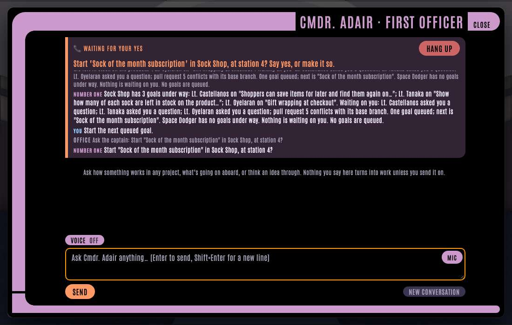

# Calls to Number One

Press **📞 Call** in Number One's panel (<kbd>1</kbd>) and talk to the ship hands-free: no push-to-talk, no reading. A call can:

- **How things stand.** "What's the crew doing?", "How's the Sock Shop?" The goals under way and who's on them, who's at work on issues, what's waiting on you (the same rule as [Comms](comms.md)), and the next queued goal. It's read straight off the board, so it's exact.
- **Start the next queued goal.** "Start the next queued goal." The ship asks first, naming the goal, the project and the station: *Start "Sock of the month subscription" in Sock Shop, at station 4?* Only a clear yes ("yes", "go ahead", "make it so") starts it. Anything else, or no answer within a minute, leaves it queued. When every station has a goal, or nothing's queued, the ship says so and asks nothing.
- **Talk something through.** "Let's talk about the wishlist goal", "Let's talk about Sock Shop as a whole." See [below](#talking-something-through).



While the call's on, the strip at the top of the panel says what the ship is doing (listening, working it out, waiting for your yes, starting it), what's waiting for your yes or your words, the topic you're talking through, and the captions: what you said, what the ship said, and, muted, what the office told it to say. The call carries on with the panel closed, so you can walk round the ship. **Hang up** ends it from any screen. A new call hangs up the one before: there's one at a time.

## Talking something through

Name a goal under way, a closed goal, or a project as a whole, and the office briefs the voice model on it from the ship's records. Then you talk it through with it at conversation speed, without the office in the loop for each turn: a requirement, an idea, why something keeps going wrong.

- **What it knows.** For a goal: how you first put it, the lead's note (what done looks like, this slice's checklist, what the slices taught, ideas for next, open loose threads), each slice so far, its pull requests and their QA badges, and what the [ledger](ledger.md) saw: QA rounds, conflicts, sessions, and the moments its sessions got stuck, quoted. A closed goal gets the same, from what its room kept. A project gets its goals under way and queued, the latest closed goals and what they taught, its open issues, the last fortnight's QA and merges, and what keeps getting in the way, from the [retro](retro.md)'s reading of sessions.
- **What it doesn't.** The code, and the lead's own conversation. It says so when something isn't in the record, rather than guessing.
- **Turning it into work.** "Make that a goal" or "tell the lead": the ship asks what to put in it, you say it, and it reads it back: *Start a new goal in Sock Shop: "Find out why pull requests fail QA, and stop it happening"?* or *Send Lt. Data: "Ship it once the list page works"?* Only a clear yes does it. The new goal, or the message, carries the conversation since you picked the topic, so its lead knows what you talked about. With every station taken, the goal is queued. "Never mind", or a minute's silence, drops it.

## How it works

It's the stack Alex Hillman's JFDI voice mode ended up with: a realtime voice model for the conversation, a fast "System One" model for quick decisions, and a state machine that keeps each task on rails.

- **[gpt-live-1](https://developers.openai.com/api/docs/models/gpt-live-1)** (OpenAI) holds the conversation: it listens and speaks at once, and decides when to hand the captain's words over to its backend. The office is that backend (*client delegation*). Your browser carries the audio straight to OpenAI over WebRTC. The office creates the session with the browser's offer, and lets the browser's own events channel do nothing but hang up. It then attaches a sideband of its own to the session, which hears the transcript and each hand-over, and sends back what the ship should say.
- **[Jev](https://docs.typesafe.ai/api)** (TypeSafe) decides what the captain asked for. Given the call so far and what they just said, it answers typed questions in one pass, each with a calibrated probability: which action (status, start the next goal, or something else), which project, and, when a start is waiting, whether that was a clear yes. A pick under 0.6 confidence counts as unclear. A yes counts at 0.9 or more, judged on the captain's own transcribed words, not on what the voice model made of them.
- **The call's machine** ([XState](https://stately.ai/docs/xstate) v5) is the rails: *listening* → *routing* (Jev) → *confirming* → *acting*, and back to *listening*, with *dictating* while it waits for your words for a goal or a lead. A briefing goes to the voice model as background (`session.thinking.append`, a piece of up to 500 tokens at a time). Anything consequential (starting a goal, a new goal, a word for a lead) is done only from *confirming*, only the one it asked about, and only when routing found a clear yes. The office checks again, as it starts it, that the goal is still in line and a station is still free. A hand-over that comes in while the machine is busy is routed once it's free.

Each call costs gpt-live-1's $0.05 a minute, plus Jev's fraction of a cent per hand-over. What you say goes to OpenAI and TypeSafe.

## Setting it up

Set both keys where the office starts, then restart it:

```sh
OPENAI_API_KEY=sk-… TYPESAFE_API_KEY=… pnpm start
```

Until both are there, the Call button is greyed out, and its tooltip says which is missing. The browser asks for the microphone the first time you call. On the [Tricorder](tricorder.md), over Tailscale's HTTPS, the same works from your phone once it has a Call button of its own.

`FOCUS_LIVE_VOICE` picks gpt-live-1's voice (`cedar` by default; it has 22, among them `marin`, `sage` and `verse`). `FOCUS_LIVE_MODEL`, `FOCUS_LIVE_URL`, `FOCUS_JEV_MODEL` (`jev-latest`) and `FOCUS_JEV_URL` point somewhere else.

In demo mode a call needs no keys and has no audio: the captain's side is scripted (the status, then Sock Shop talked through and made into a goal), the ship's own side of the talk is canned, Jev's answers come from keywords, and the machine runs for real against the demo office.

## In the code

`server/call/`: `live.ts` (the session and its sideband, and the voice model's instructions), `jev.ts` (Jev's API), `route.ts` (the questions Jev is asked and what its answers mean, pure), `status.ts` (the spoken status, pure), `brief.ts` (what can be talked through, and the briefing on it, pure), `machine.ts` (the rails), `calls.ts` (a call: the session's events into the machine, its replies back out), `demo.ts`. In the browser, `client/src/ui/call.ts`.
