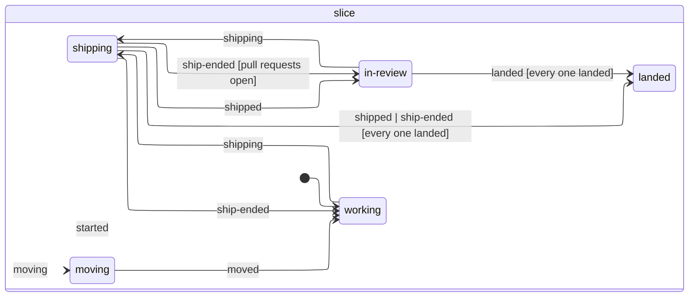

# Goals and their leads

Each goal has a lead of its own: your own Claude Code session for that goal, at a team station of its own, which you talk to like any Claude Code session.

- **Their workspace:** every repo of the project, checked out side by side on the slice's branch, so a change that runs through the API, the web app and the admin app is just one piece of work. When a repo first ships in the slice, Ops renames its branch after the ship's title, so the pull request's branch says what it does; a repo with a pull request open keeps its branch. A goal starts titled with your first words; Haiku's short title replaces them unless the lead has retitled it meanwhile.
- **How they work:** their prompt says what you want of them and how Ops works, and leaves how to run a slice to them. What you want: shape the goal first (talk it through briefly: what, why, what done looks like, no spec); prove risky assumptions early; bring real things back for judgement calls (running code, a screenshot, a mockup, a model of the code), and otherwise make a sensible call and say so; and keep pull requests reviewable. Ops doesn't make them keep a checklist, name a slice or keep the note short: the chart is drawn from what they actually do.
- **Their workflows:** with autonomy on ask, the lead asks you once before running a workflow, and approving it lets that workflow's own agents run their commands without asking, for that run, rather than every one of them raising the lead's hand. A workflow runs on after the lead's turn ends, and the lead keeps listening meanwhile, so a message you send while it runs reaches them straight away rather than after the workflow ends. So does anything else they have running in the background, a shell or a monitor: Claude Code keeps the session going until it ends anyway. It keeps listening through the turn Claude Code takes for the last task's result, and stops once that's over, or a minute on if no turn comes: stopping as the task ended left that turn nobody to ask, and Claude Code cancelled each tool it needed approval for with "The user doesn't want to take this action right now". A workflow Ops has seen start and not end holds it open too, whatever Claude Code lists. So does a message sent just as a turn ends, which Claude Code takes in a turn of its own: Ops waits for that turn rather than closing on it.
- **Shipping a slice:** they never push. When a slice is ready they ask Ops to ship it (`mcp__office__ship`, which in **ask** mode raises their hand for you to approve first). Ops pushes every repo with new commits since it last shipped and opens a pull request in each (or updates the one it opened), and QA reviews them as [QA](qa.md) says. Nothing ships while any repo has uncommitted changes. Like a developer's push, it fetches with `--prune` first and rides out a few GitHub 5xx answers (see [agents](agents.md)).
- **Hearing back:** only you start a lead's next turn. What Ops and QA have for them (QA's verdict on a pull request, pass or fail, their slice landing, Ops merging a base into their pull request) is a note: kept in their run journal, so a restart doesn't lose it, and heard with the next message they get, ahead of it, whether that comes mid-turn or starts their next one. A note never wakes them, and never carries a turn on as it ends. A QA fail says so in a toast: the lead waits on you (or, mid-turn, hears it with their next message, and if the turn ends without one, the lead waits on you then). None says so when a plugin's message for it picks the lead up, brings it into their turn, or is held for your plan's usage limit. A fail's note doesn't say when to fix it: the message it comes with does. Waking them for news was core's until it wiped the turn you hadn't read yet, and with it what the lead had asked you; a plugin can still wake them for a note (it hears of each one), and [the chief of staff](../plugins/chief-of-staff/README.md) does, for a QA fail it sends back and a slice that's landed, unless you owe the lead an answer. You merge their pull requests (they don't merge by themselves). Once every pull request of the slice has merged or closed, their repos move to fresh code on a new branch for the next slice at the start of their next turn. A repo with uncommitted changes holds the move back, so nothing is lost. Commits they made after shipping are cherry-picked onto the new branch, and when they don't apply cleanly, they stay on the old branch and the lead is told how to bring them over. If the move's checkout fails part way, their next message checks every repo out again on the new branch first, and they hear so. A branch never ships again once a pull request from it has merged: a squash merge leaves its own commits off the base, so a new pull request from it would carry them again and conflict. When the lead ships a repo whose pull request merged while the slice's others are still open, Ops first moves that repo to a new branch from fresh code, cherry-picking only the commits that never shipped, and tells the lead; if they don't apply cleanly, nothing ships and the lead hears how to bring them over. If you merge (or close) a pull request while Ops is pushing to it, Ops looks again once the push is done: one that landed meanwhile stays landed, rather than being "updated" and put back as open, and the commits the ship pushed are carried as any unshipped commits are. (A closed one leaves its branch fit to ship again.) A ship whose pull requests have all landed by the time it's done has landed the slice.
- **The goal's note:** the lead keeps a note on the goal through Ops (`mcp__office__note`): what done looks like, a line or two on what each slice taught them, and ideas for what's next. Ops doesn't limit how long it gets or ask for a checklist in it. The lead hears it again at each new slice, so it survives their conversation being summarised. Ops also keeps your first words on the goal, and the lead hears them with the note at each new slice and when their conversation is compacted, or has to start afresh.
- **The goal's chart:** Ops keeps a waypoint for each slice as the lead works, with what it set out to do, its lessons, QA's verdicts and spot-checks, and QA's screenshots copied into the goal's own files, since the review and the board's entry are both gone once the pull request lands. A re-test's spot-checks replace the last round's, keeping your tick on any it picks again. **Contacts** are the loose threads a lead noticed on the way, logged with the note tool rather than chased, so they aren't lost the way an idea for next is when that's rewritten; one spun off as a goal of its own is the new goal's, and its lead hears so. A goal's course is laid out from its id, so it always meanders the same way. The rules the chart is held to are measured in `client/src/ui/legibility.ts` (no label over another, a mark or a line, labels kept apart, no leaders crossing), and its tests hold a busy voyage to them with each waypoint in focus at several zooms.
- **Their context:** a goal can run for a long time in one conversation, and every step of a turn reads the whole of it again, so a big one is the costliest part of a goal (over 30 days, three quarters of what leads' own conversations cost came from steps that read more than 200k tokens). So before a lead's next turn, once their conversation has grown past the threshold in Focus's settings (**Compact a lead's conversation from**, 0 to switch it off), Ops compacts it first, telling Claude Code what to keep: between turns, so never in the middle of one, and never in a cloud session. If it can't, it carries on as it is and doesn't try again in that conversation. Tested on a real lead's 627k conversation, the compacted one (a few thousand tokens) answered a blind-graded quiz on the goal (what you asked for, your pushback, the decisions, each PR and what became of it, what's next) almost as well as the full one, 15 points to 16: what it lost were details like file and line numbers, which the code and GitHub still hold. Claude Code still compacts by itself when a context fills up. Leads are also told to hand broad exploration to subagents and keep only their conclusions.
- **How hard they think:** changing it costs a little, since the prompt cache starts over.
- **One per goal:** their record lasts as long as the goal, from slice to slice. Their instructions say who they are and how they work, and stay the same for the whole goal (Claude Code keeps a session's first system prompt when it resumes); where their repos are, and on which branch, comes in messages. Other leads may be working in the same repos at the same time, each on their own branches.
- **Showing you things:** the lead can put a visual on their station's big screen (`mcp__office__show`). Up close, the page runs sandboxed in an origin of its own, so its scripts can't reach Focus. They stay with the goal when it closes, with the questions you answered and what you picked, and reopening the goal puts them back on its screen. They're kept for good, even after the goal drops off the end of the room's log: they're often the best record of why something was built the way it was. `GET /api/goals/archive` (`?project=<id>` for one room) lists every goal the ledger saw close, with its artifacts and questions.
- **Models of their code:** when you need to understand how real code works, or what a slice changes, the lead shows you a model recovered from the code rather than a hand-drawn diagram (`mcp__office__model`): every part and connection is cited at the file and line in the lead's workspace, and Ops checks every cite before you see it, flagging what didn't check out, and draws every model the same fixed way.
- **Asking you with pictures:** for a question best answered by looking, the lead asks it with options (`mcp__office__ask`), and your pick goes to the lead as a message from you. Any message you send them while a question's open settles it as answered in chat, with what you said kept beside it: the lead reads your message and acts on it, and Ops doesn't guess which option you meant.
- **Ending a goal:** when what done looks like is met, or a slice lands and nothing worthwhile is left, the lead says so (`mcp__office__propose_close`), and you close it, or carry on talking. Closing never throws work away: uncommitted changes are committed as a WIP snapshot on the goal's branch before its checkouts go (and if that fails, the goal stays open). A goal can't close while its slice is shipping (so its pull requests stay with the goal), nothing ships once a close has started, and if Focus stops part way through a close it finishes the close when it starts again, rather than the lead picking up a goal whose work is half committed. It asks first if that leaves work only in the clone Ops keeps (a snapshot, commits never pushed, a branch that never reached GitHub), leaves pull requests open with no lead, or closes a goal that shipped nothing; a checkout git can't look at counts as having changes. A closed goal keeps what it taught you, the branch each repo was left on and every slice's pull requests. **Reopen** brings the same lead back to a free station, with every repo on the goal's branch as it was left (the WIP snapshot at its tip), and picks their conversation back up.
- **When every station is taken:** a new goal waits in line for a team station. Goals in line never start by themselves. A goal you write at a free station you walked up to still starts there and then, ahead of any in line: you picked the station for it.

Leads don't take one of the holodeck's individual desks or count towards its agent limit. They do count towards **Agents working at once** while they work: a message to a lead (or any agent) that has finished its turn waits for a free slot like anyone starting work.

## Why it's built this way

From Anthropic's guidance when goals were designed (prompting guides, *Harness design for long-running application development*, the compaction docs):

- A 1M window doesn't remove the need for context management: long runs get summarised, so what must survive (the goal's note) lives outside the conversation.
- Anthropic's own harness moved from context resets with handoff files to plain compaction once models could hold a multi-hour build. What stayed useful was a short "what done looks like" agreed per chunk, not up-front specs.
- Compaction works best when the harness chooses the moment and says what to keep.
- The doer and the judge stay separate (QA).
- "Don't stop to report" prompting is for unattended agents; a lead tells the captain and stops.
- On `resume`, Claude Code keeps the first system prompt until the next compaction or a new session, so anything that changes goes to a lead as a message.

## The slice journal: a ship or a move that Focus cut off

Each goal keeps a slice journal, `~/.focus/runs/slices/<lead id>.jsonl` (`server/agents/sliceJournal.ts`), like an agent's run journal ([agents](agents.md#the-run-journal-where-a-run-was-and-picking-up-after-a-restart)): numbered facts, each flushed to disk before Ops acts on it (`Store.sliceJournal`), never rewritten. A ship and a slice's move to fresh code both happen on GitHub and on disk, where a crash can cut them off part way, so the journal says how far they got: `started` (the goal's first slice and its branch), `shipping` (the title and summary, written before anything's pushed), a `pr` for each pull request opened or updated (repo, number, commit, branch), `shipped`, or `ship-ended` when nothing shipped; `landed` as each pull request merges or closes; `moving` (the next slice, its branch, the checkouts that go and the commits that never shipped, decided before any checkout goes) and `moved`. What they add up to is a state machine's (`sliceMachine`, XState), drawn from its code (a test keeps this picture in step):

<!-- slice-machine:start -->

<!-- slice-machine:end -->

**After a restart** (`Slices.recover`, before the leads' own runs are recovered; `sliceRecovery` decides):

- a ship Focus cut off is shipped again by Ops, with no Claude turn: each repo pushed again, its pull request found or opened, QA asked for it (every step is safe to repeat);
- a move to fresh code Focus cut off is finished from what was decided: the old checkouts go, every repo is checked out on the new branch, and the commits that never shipped are brought over. A move a failed checkout left part way is finished the same way at the lead's next turn;
- the lead's own turn then picks back up as any agent's does (on your plan, in the same conversation), and they hear what Ops finished with it, or with your next message;
- pull requests the saved state lost are put back from the journal, so Ops notices them merge.
