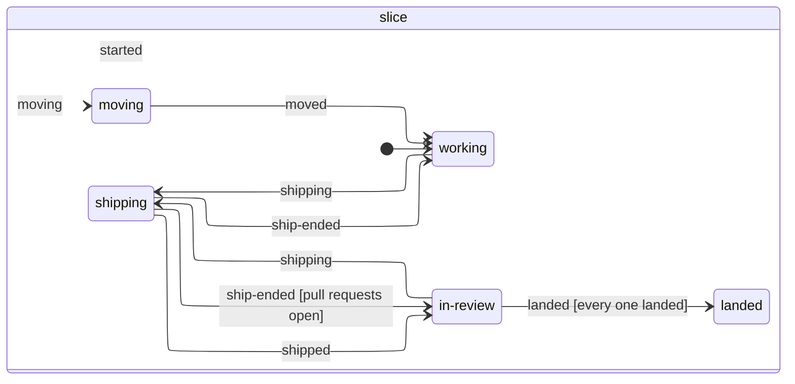

# Goals and their leads

A holodeck works on up to four goals at once, one per **team station**. Each goal has a lead of its own, a lieutenant in command red: your own Claude Code session for that goal. Open the holodeck's goals with <kbd>L</kbd> anywhere on it, **Goals** on its board, or its button in [Comms](comms.md) (<kbd>C</kbd>), which also lists every goal under way on the ship and hails you when a lead is waiting for you; <kbd>E</kbd> on a goal's team station (or its lead) opens the lead's panel. Each goal shows its lead, its slice and its pull requests: **Talk** opens the lead's panel, where you talk to them like any Claude Code session. To start another, tell the box at the bottom what you're after and pick how hard the lead thinks (**Effort a new goal's lead starts at** in Settings sets the default, high to begin with). A lead of its own takes the first free station, or the one you walked up to: <kbd>E</kbd> on a free station opens the goals list to start a goal there. However you start one (here, or **To a goal** from the Ops station or Number One), a toast says which station its lead took, with **Beam there** to go straight to its briefing room.

The holodeck is a **training hall**, like the hall of training pods in Lower Decks' "I, Excretus": a round hall 22 m across, far bigger than the holodeck's slot on the deck could hold, since its door is a doorway to it (as each pod's door is to its briefing room). The board curves round the far wall, high enough to read over the desks, and the desks, the QA station and the Ops station stand in the control ring in the middle, and the pull requests waiting for you lie on the **PADD rack** by the door, a pile of PADDs each, the top one's cap lit in how QA has it (<kbd>E</kbd> on it opens the board's pull requests). The **team stations** are four holo-pods round the wall either side of the board, like the ones the Lower Decks crew train in: a cream shell with a ribbed ring in the station's colour on top, and a door through a thick bezel at the front. Over each floats a holographic sign, like the ones over the holodeck pods in Lower Decks: the station, its goal and lead, and how far through the slice they are (its tasks done, as a percentage), a hologram like the team screens, slightly see-through and bobbing gently, its outline glowing in how the room stands. The lamps either side of the door say the same at a glance: dark while the station's free, breathing cyan while the lead's at work, pulsing gold while they need you, steady green when it's your turn, red once they've stopped. Each door opens onto the goal's **briefing room**, which stands somewhere else entirely: it's drawn through the open door from where you'd be standing on the other side, and stepping over the threshold moves you there, facing the same way, so you just walk in (and out again the same way). It's a round mini bridge, about 11 m across, with three screens side by side across its front, each on a flat stretch of the curved wall and facing the middle: the goal board to port, the viewscreen dead ahead and the goal's star chart to starboard. A few steps in from the door you're standing on the command carpet in the middle of the room, with nothing between you and the screens, and from there the viewscreen fills the middle of your view, with the work going on now side by side (the lead's terminal, what they've shown, their browser and Claude's task list), the station's sign lit on the dado under it. The lead sits at your right hand and the goal's reviewer at your left, as the first officer and counsellor do on the bridge, and their helpers two to each of the curved consoles round behind, trimmed in the station's colour, an LCARS panel for each of them along its top, with the walk in from the door between them; each of them has a PADD, and all face the screen. To get closer still, walk on up to it. Windows onto space look out on either side. The **star chart** to starboard is Stellar Cartography's screen (`ChartScreen` in `goalScreens.ts`): the goal's course, laid out as the chart panel lays it (`plotCourse`), with the shield rings, scrubbed headings, contacts and projected courses, its words half as big again so they read from the carpet (laid out for that size, so they don't run into each other), and down its right-hand side the waypoint under way, its tasks, shields, the spot-checks still to look at and the contacts still open. <kbd>E</kbd> on it opens the full chart (below). The **goal board** to port of the viewscreen is the goal itself, an LCARS screen like the viewscreen (the room's framed screens share its look; holograms are kept for what floats in the holodeck): an elbow in the station's colour with its code, the goal's title in full across the top beside how the room stands, and under it this slice's tasks with a bar for how far through them they are, and what done looks like; beside them who's on the team like the crew leaderboard in Lower Decks, each with a portrait of their own character, name, part and what they're doing, the slice's pull requests and how QA stands on each, then what might come next and the latest lessons (before there's a note, the goal as you first put it). Along the bottom of the board, the plugins switched on can add a strip of their own: the `flow` plugin's says where the goal's time is going ([where goals' time goes](../plugins/flow/README.md#live-on-the-goal-board)): what it's waiting on now and for how long (and why, when it's you), and a bar of its time so far; the goals list's card for it has a **Flow** readout saying the same, as does its line in [Comms](comms.md). Its text wraps rather than running off: the type shrinks until it all fits, next and the lessons move over under the goal when there's no room for them under the crew, and only when even the smallest type can't fit them are the lessons, then what's next, left off. Press <kbd>E</kbd> on anyone in the room, or on their row on the goal board, for their terminal (a helper's transcript), or anywhere else on the board for the lead's goal and to-dos. Teleporting to a lead puts you on the command carpet, facing the screen. A free station's screen, sign and board say it's free, or which goal is next in line. Goals show as in progress on the holodeck's board too, whether or not their lead is at work right now: click one for its lead's panel, or **Beam there** on it for its briefing room.

Each pod has its team's **screen** hung over it, tipped down to the middle of the hall, TS-1 to TS-4 left to right as you come in, so you can watch every team at once from the control ring without going into any of their briefing rooms. Each one shows how its room stands in big type across the top (In session, Needs you, Your answer, Your turn…), each a hologram hovering in the air over its pod, slightly see-through and solid while you aim at it, its outline lit and pulsing in its room's tone the way the door's lamps are (a free station's dimly, in cyan); the goal; what the lead's up to right now (or what they're waiting on you for: an approval, an answer, closing the goal), beside their portrait; how far through the slice they are, with what's left of its tasks (done items fold into one line); and along the bottom who else is round the table (the reviewer and helpers) and the slice's pull requests, each marked open, QA testing, QA passed, QA failed, merged or closed. A free station's screen says so, or which goal is next in line. <kbd>E</kbd> on a screen does what it does at that station's door: talks to its lead, or starts a goal there.

- **Their workspace:** every repo of the project, checked out side by side at `./<repo>` on the slice's branch, so a change that runs through the API, the web app and the admin app is just one piece of work. They read each repo's CLAUDE.md, run its tests and check UI changes in the browser, like the rest of the crew. The branch starts with a working name from the goal (`focus/<goal>-<slice>-<id>`); when a repo first ships in the slice, the office renames it after the slice's work, from the ship's title (`focus/<title>-<id>`, `shipBranch` in `lead.ts`), so the pull request's branch says what it does. A repo with a pull request open keeps its branch, and the lead hears of the rename in the ship's reply. A goal starts titled with your first words (`goalTitle`); Haiku then gives it a short title that says what the work is (`titleGoal` in `claudeCrew.ts`, `server/agents/goalTitles.ts`), which replaces it unless the lead has retitled it meanwhile (the demo's goals keep your words).
- **How they work:** their prompt (`leadSystemAppend` in `lead.ts`) says what you want of them and how the office works, and leaves how to run a slice to them. What you want: shape the goal first (talk it through briefly: what, why, what done looks like, no spec); prove risky assumptions early; bring real things back for judgement calls (running code, a screenshot, a mockup, a model of the code), and otherwise make a sensible call and say so; and keep pull requests reviewable. The office doesn't make them keep a checklist, name a slice or keep the note short: the chart is drawn from what they actually do.
- **Their helpers:** when they hand independent pieces of work to subagents (Claude Code's Agent tool), each one sits down at one of the curved consoles in the lead's briefing room as an ensign with a PADD while it works: its bubble shows what it's doing (from Claude Code's progress summaries, about every 30 seconds, and its tool calls). It says how it got on when it reports back, then leaves. Four seats; any more wait for one. They're listed under **Crew** in the lead's panel too. Press E on one, or click it under Crew, to see its own transcript: what the lead asked of it, its tool calls and what it reported back, without the lead's conversation round it (the lead's terminal shows only the Agent call and its answer). Its header shows the model it runs on (from its first message) and its effort, which is the lead's: Claude Code doesn't report a subagent's effort, and subagents think at their session's, so it's marked inherited. It's kept in memory while the helper's at the station, and stays up in an open panel after it leaves. A helper started by another helper rather than the lead says whose it is: its bubble's tag, its row under Crew and its panel's title read "for Ens. …" (`Helper.parent`); it sits at a console like the rest.
- **What they leave running:** a command the lead leaves running in the background (Claude Code's Bash with `run_in_background`, like `pnpm run dev`) or a monitor watching for something floats beside their chair as a small holographic **probe**, in the holograms' navy glass and glowing outline (`world/probes.ts`): a command is a slowly turning terminal cube with `>_` on its faces, a monitor a little dish sweeping to and fro. It glows cyan and breathes while it runs, then green when it's done, red if it failed, grey if it was stopped, under a label with the command (cut short) and how it stands. Up to four float in a short arc at head height on the side of the chair away from you, bobbing gently; any more show as '+N'. They shimmer in when a task starts, and fade out 15 s after it ends, when it leaves the lead (`Agent.background`). Press E on one, or click it under **Crew** in the lead's panel, for its panel: what it runs, how long it's been running (or how it ended), and the tail of its output, read again every 2 s while it's open (`GET /api/agents/:id/background/:task/output`). **Stop** ends it, once you've confirmed, and the lead hears that you did; if the lead's session isn't listening any more, the panel says it couldn't.
- **Their transporter rooms:** a lead can run Claude Code workflows, scripts that run up to 16 agents at once, and each workflow that's running has a **transporter room** of its own, as on the Enterprise-D: each team station has three, standing far out in the world beyond main engineering (`transporterRoomAt` in `layout.ts`), since nobody walks in or out: you beam in, and back. Each is built in Blender (`blender/transporter_room.py`, dressed by `world/transporterRoom.ts`): along its back wall a platform of three tiers stepping up from the floor (0.2, 0.4 and 0.6 m), six pads on each, 18 in all, each with a lit ring and an emitter over it in the canopy, in front of a backdrop of tall light panels; the transporter console in front of it, facing it, with you arriving a few steps behind it, where the whole platform and the tactical display are in view at once (<kbd>E</kbd> on the console energises, to beam you back to the briefing room, and so does <kbd>E</kbd> on the sealed door); the pattern buffer's two glowing columns in niches either side of the platform, with its readout on the port wall beside them; the tactical display, a big LCARS screen hinged out from the starboard wall and turned to face where you arrive; and a sealed door with its sign over it. The strips along the platform's steps and the buffer's bands are in the station's colour. The agents at work stand on the pads, each pad's ring and the light across it glowing in their phase's colour, breathing while they work and turning green or red as they finish (`world/padGlow.ts`), those still queued are patterns held in the buffer, and the tactical display shows the run as a **rail map** (`world/railMap.ts`, drawn by `world/railMapScreen.ts`), from the workflow's roll: the lead's line fanning out into a track for each item its script works on (an item is the part of an agent's label after its first colon, so `scan:views` and `check:views` ride one track), through a station for each phase, lit in the phase's colour as far as the item has got, green once it's through and ending at a red buffer stop where it failed, the tracks merging into one line where a phase shares no items with the one before, a section of more than eight items running as one thick bundle with a dot per agent, and the line on to the report for the lead. <kbd>E</kbd> on it switches to the LCARS view, which follows the operation phase by phase, with what each is for under its title and the phases the script plans but hasn't reached yet, and back: a choice kept in your browser (`railPrefs` in `world/flowPrefs.ts`); a camera up in the corner over the door looks at the platform, for the briefing room's feed of each. The console's sloping top shows the **script** running it all (its LCARS keys while the room stands by): the source down the left, round the lines that are running now, lit in their phases' colours (where it named a phase with agents at work, and where it labels an agent at work, as written or by the start of a label built from a template: a guess from the script's words, since Claude Code doesn't say which line it's on, `runningLines` in `workflowRooms.ts`), who's at work down the right with the last few results to come back, read from the journal Claude Code appends to as each agent returns (`journalResults` in `workflows.ts`, read again a moment after each agent finishes), and once it's over what it said with `log()` and the start of what it returned, with the tokens and tool calls it has used along the bottom. <kbd>E</kbd> on the console's screen opens the script full size beside its phases and every result back so far, newest first, each opening to the whole of it (`ui/workflowScriptPanel.ts`); the **Energise** button beside the hologram's switch in its corner, and the rest of the console, still beam you back. Over the console, clear of the agents' speech bubbles from where you arrive and tipped down to face you, the script's **flow** hangs as a hologram in the probes' navy glass (`world/flowHologram.ts`): its phases as nodes in a row in their colours, each with what it's for and how many of its agents have come back, the ones with agents at work glowing, and after them where it returns to the lead (`flowNodes` in `workflowRooms.ts`). It's the key to the pads' colours: each pad glows in its phase's colour, so there are no lines from the nodes down to the agents. As an agent finishes, a spark rises from its pad into its phase (green, or red if it failed: `finishedOnPads`), and when the workflow's over the return lights and a spark beams up out of it, towards the briefing room. <kbd>E</kbd> on the hologram reads the script too. The switch in the bottom corner of the console's screen (**Hologram · On**) shows or hides it over every console, a choice kept in your browser (`world/flowPrefs.ts`), and the briefing room's monitors leave it out, showing just the platform (`TransporterRoom.offFeed`). In the demo, message a lead "run a workflow" and they run their review workflow there and then, to watch in their transporter room. The office keeps the script from the lead's Workflow call (or reads it from where Claude Code saved it, for a saved workflow), reads the phases its meta plans from it without running it (`scriptPlan` in `workflows.ts`), counts what it uses from its progress, keeps every agent it has queued in the workflow's `roll` (just each one's label, phase and status, the queued ones too: the rest of what's known about an agent is kept only for those at work and the last few back, `workflowProgress` in `workflows.ts`), and serves the source, with the log and result from the run Claude Code saves in the session's folder as it ends (`workflowScript` in `manager/sessions.ts`), when the console asks. Press <kbd>E</kbd> on anyone on the pads for their own screen: the transcript Claude Code writes as they work (what they were asked, the tools they used and what came back, what they said), read again every couple of seconds while it's open (`workflowAgentLines` in `manager/sessions.ts`, rendered by `transcriptLines` in `workflows.ts`); you talk to the lead, not them. With autonomy on ask, the lead asks you once before running a workflow, and approving it lets that workflow's own agents run their commands without asking, for that run (`WorkflowPermits` in `workflows.ts`), rather than every one of them raising the lead's hand. A workflow runs on after the lead's turn ends (Claude Code keeps the session going until it's done, then gives Claude a turn to take its results), and the lead keeps listening meanwhile, so a message you send while it runs reaches them straight away rather than after the workflow ends. So does anything else they have running in the background, a shell or a monitor (`holdsInput` in `claudeRunner.ts`): Claude Code keeps the session going until it ends anyway, and while it's listening a message reaches the lead and **Stop** on a probe works. It keeps listening through the turn Claude Code takes for the last task's result, and stops once that's over (`Listening`), or a minute on if no turn comes, which the lead's terminal notes with "✻ Stopped listening": stopping as the task ended left that turn nobody to ask, and Claude Code cancelled each tool it needed approval for with "The user doesn't want to take this action right now". A workflow the office has seen start and not end holds it open too, whatever Claude Code lists (`runningInBackground`). Only the room you're in is drawn (`World.reveal`), or the one a feed reveals. Each feed is a whole extra frame to draw, so a feed is drawn only while its room has a workflow in it and its monitor is in view, eight times a second, one feed a frame at most (`world/transporterFeeds.ts`).
- **Shipping a slice:** they never push. When a slice is ready they ask the office to ship it (`mcp__office__ship`, which in **ask** mode raises their hand for you to approve first). The office pushes every repo with new commits since it last shipped and opens a pull request in each (or updates the one it opened), and the holodeck's QA officer reviews them. Nothing ships while any repo has uncommitted changes. Like a developer's push, it fetches with `--prune` first and rides out a few GitHub 5xx answers (see [agents](agents.md)).
- **Hearing back:** a QA fail goes straight to them, and they fix it and ship again, twice at most before it's yours to look at. A pass is passed on with your next message. You merge their pull requests from the board (they don't merge by themselves). Once every pull request of the slice has merged or closed, they hear about it, and their repos move to fresh code on a new branch for the next slice at the start of their next turn. A lead that's idle wakes for it and is told to carry on with what's next, unless it's your call (`landedNote` in `lead.ts`), in a line rather than the whole routine again. Waiting for a go-ahead after each slice was the biggest wait on the captain ([where goals' time goes](../plugins/flow/README.md)). A lead in the middle of a turn is told to carry on where they are (`landedMidTurnNote` in `lead.ts`), since their commits come along, and to share what it taught them when they next report. A repo with uncommitted changes holds that back, so nothing is lost. Commits they made after shipping come along: the office cherry-picks them onto the new branch, and when they don't apply cleanly, they stay on the old branch and the lead is told how to bring them over (`carriedNote` in `lead.ts`). If the move's checkout fails part way (the office restarting mid-fetch, say), the lead is left with no repos and nothing landed to move again, so their next message checks every repo out again on the new branch first, and they hear so (`reposBack` in `manager/slices.ts`, `reposBackNote` in `lead.ts`). A branch never ships again once a pull request from it has merged: a squash merge leaves its own commits off the base, so a new pull request from it would carry them again and conflict. When the lead ships a repo whose pull request merged while the slice's others are still open (or the next slice is held back), the office first moves that repo to a new branch from fresh code, cherry-picking only the commits that never shipped, and tells the lead (`needsFreshBranch` and `freshBranchNote` in `lead.ts`). If they don't apply cleanly, nothing ships and the lead hears how to bring them over.
- **The goal's note:** the lead keeps a note on the goal through the office (`mcp__office__note`): what done looks like, a line or two on what each slice taught them, and ideas for what's next. The same tool logs and closes the goal's contacts (see the chart, below), and retitles the goal. What one call of it leaves the goal as (its title, note, contacts and waypoints) and what it says back are decided together in `notedGoal` (`lead.ts`). The office doesn't limit how long it gets or ask for a checklist in it. It shows on the goal in the goals list and above the lead's terminal, and the lead hears it again at each new slice, so it survives their conversation being summarised. The office also keeps your first words on the goal, and the lead hears them with the note at each new slice and when you compact their conversation, or it has to start afresh.
- **The goal's chart:** **Chart** on a goal's card in the goals list (and on a closed goal's, once it kept one) opens its star chart, Stellar Cartography: the goal's slices as waypoints on a course from where it launched towards the objective, what done looks like, glowing hazily in the top corner, never quite reached. The office keeps a waypoint for each slice (`server/agents/waypoints.ts`) as the lead works: what it set out to do, from the title and opening of the description it first shipped with (shipping again to fix what QA found changes the pull requests' code, not what they say, and the waypoint keeps it the same way), each lesson the lead adds to the note about it, when it started and when its last pull request landed. Leads say what a slice taught them once it's landed, by when the next has begun, so until the new slice ships something, what they note goes on the one that landed (`notedSlice`). The slice under way is on the chart from the start, not only once it ships: until it ships under its own title it goes by what the lead's at, in italics: the task it's doing now on its own task list, else its last commit (`waypointName` in `client/src/ui/course.ts`), and with neither, "under way" (a goal's older waypoints may wear the heading leads used to give them). Leads keep a task list for themselves with Claude Code's task tools (TaskCreate, TaskUpdate, TaskList: a session only has them with `CLAUDE_CODE_ENABLE_TODO_TOOLS`, which the office sets, `agentEnv` in `claudeRunner.ts`), and each waypoint keeps the tasks the lead added or moved on during its slice, as they last stood (`taskedWaypoint`, which `taskChange` in `lead.ts` applies with the list it changes); one carried over from an earlier slice and left alone isn't this slice's work, and a landed waypoint keeps its tasks on the chart. An arc round the slice under way fills as its tasks get done (`sliceSteps` in `client/src/world/goalRoom.ts`; a slice without any has no arc, since newer models often work without a written list), and the office counts the lead's commits as they make them (`gitCommit` in `server/agents/commits.ts` spots a `git commit` in a Bash call, `committedWaypoint` counts it once git says it worked), so its log shows the work so far with the last commit's message. When the lead changes what done looks like, that's a course correction, on the same slice: the course swings over at that waypoint, and the old heading carries on from it, dashed and crossed out, **Scrubbed**, with what done used to say. The slice under way pulses; the lead's ideas for what's next fan out ahead of it as dotted courses; space the voyage has been through is clear, and the rest is fog. **Contacts** are the loose threads the lead noticed on the way (a question, a risk, an idea off the course), which they log with the note tool rather than chase, so they aren't lost the way an idea for next is when that's rewritten: each is a sensor blip off to the side of the waypoint that noticed it, sky blue while it's open, green with a dotted trail to the waypoint it went into once the lead pursues it, and struck through once they drop it (with why). A lead keeps at most eight open at once, and hears the open ones with the note at each new slice and when their conversation is compacted (`server/agents/contacts.ts`). **Probes** are what the lead sends out to explore: a helper (a subagent: mapping a repo, research, a long test run), or a script it runs from its scratch dir to try something (`scratchScript` in `scratch.ts` spots one: `node`, `tsx`, `python3`… on a file there, not writing, listing or removing one). Each launches from the waypoint under way as the helper sits down at the team station (or the script starts), and flies out into the fog, quickly at first then drifting, a trail back to its waypoint and what it was sent to find and what it's doing now beside it (click it for the helper's transcript). Probes launched together fan out either side of the way ahead. A script's is a short, quick hop. When the helper reports (or the script finishes, cleanly or not, with the first line it printed), the probe stops where it got to and transmits home: pulses run down its trail, green when it completed and red when it failed, with the opening of what it said, and it fades out over a few seconds (`probeFlights` in `course.ts`). The office keeps each on the waypoint that launched it (`launchedProbe` and `endedProbe` in `waypoints.ts`, the latest six helpers and six scripts a waypoint; `probedWaypoints` picks between them for a helper or a script, and `helperChange` in `lead.ts` seats the helper and charts its probe together), so they join its constellation with what came back; one that never reported (the office restarted under it, or the session stopped mid-script) is marked as lost contact. They fly on the briefing room's wall chart too, which redraws while any are in flight and you're in the room. Each waypoint wears a ring of **shields**: QA's verdict on each of its pull requests goes on it as it arrives (`shieldedWaypoint`), with how its checks went and how CI stood then, since the review and the board's entry are both gone once the pull request lands. The ring's green when everything passed first time, gold when a hit was absorbed (QA failed a pull request, then passed it once it was fixed: a guardrail that caught something), and red while QA or CI is failing one. QA's **spot-checks** for those pull requests (see [QA](qa.md)) go on the waypoint too: the places in the diff most worth your own look, which you tick off in its log as you look at them (`POST /api/agents/:id/spot-checks`); a re-test's picks replace the last round's, keeping your tick on any it picks again. The readout counts the hits absorbed and the spot-checks still to look at. Each waypoint keeps its **evidence** too, what the slice does seen rather than read: the screenshots QA last took of each of its pull requests (up to four each, copied into the goal's own files as the verdict arrives, since QA's copies go with its review when the pull request lands, and served with its artifacts), and what the lead showed and asked on the station's screen while it was under way (each visual and question keeps the slice it was last shown or asked in). They're nodes of its constellation: a screenshot opens full size, a visual or question opens the station's screen up close (a closed goal's, as it left them). Click a projected course (on the chart, or under **Projected** in the latest waypoint's log) for the idea in full, the waypoint it heads on from and the other ideas, each opening the same way. Click a contact (on the chart, or in a waypoint's log) for its own log: the thread in full, how long it's been open or when it closed, the waypoint that noticed it, and the one it was pursued in or why it was dropped, each a link to that waypoint's log. Each waypoint wears a **constellation** of its slice's work (`client/src/ui/constellation.ts`): the lead's Claude Code tasks and the workflows it has running (the slice under way's, live), its probes once they're home, its commits, what it showed and asked on the station's screen, QA's screenshots and its pull requests, each a small mark in its kind's shape and colour (red if it failed, grey if it was lost) linked back to the waypoint. Work that says the same (a script run three times) is gathered into one node, counted (`×3`). Laid out as a cartographer would, out of focus a waypoint's work is generalised to one small count close in by it; zoomed in on a waypoint, its work stands in one column off to one side, as boundary labelling does a crowded map (`column` in `constellation.ts`): a row each, evenly spaced, kinds together in order, joined to the waypoint by one leader to a spine down the column with a tick out to each row, so nothing crosses however many rows there are, and a slice with more than twelve ends with a row saying how many more are in the log. Of every side, reach and height it could take, the column takes the one that covers no name or mark and crosses no line, away from the course, on the chart if it can be and past its edge if that's the only clear room. The rules the chart is held to are measured in `client/src/ui/legibility.ts` (no label over another, a mark or a line, labels kept apart, no leaders crossing), and its tests hold a busy voyage to them with each waypoint in focus at several zooms. The chart fills the window, and its words stay the same size on screen however big it is or however far it's zoomed: they're laid out again for each zoom (`plotCourse`'s scale), so zoomed in there's room to name everything in full, and zoomed out the oldest names give way to their numbers first. A long voyage isn't squeezed into the frame: past a handful of waypoints the chart grows, the same shape, to keep them a step apart (`chartSize` in `course.ts`), and it opens on its latest stretch, nearest the objective. Zoom it with the wheel or a pinch (about the pointer), drag it about, or press <kbd>+</kbd> and <kbd>−</kbd>; <kbd>0</kbd> or **Whole voyage** shows all of it (`client/src/ui/chartView.ts`). Zoomed out past the frame, the marks (waypoints, contacts, the launch, what's next) are drawn bigger in the chart's units so they stay big enough to see, the course keeps its weight, and the work counts are left off, generalised away rather than numbers to mistake for the waypoints' own. The picked waypoint's work stands in its column once you're about halfway in. Click a waypoint (or step with ← and →) and the chart zooms in on it, fitted to take in the waypoint, its name and its column (**Whole voyage** zooms back out), with its log in the drawer beside the chart: when it started and landed, its intent, any course correction, what it taught us, its shields and spot-checks, its work as a list, the contacts it noticed, and (on the latest) what's projected. Click a node of its constellation (or step through them with ↑ and ↓) for just that: a step, a task, a workflow's phases (and its script and results), a probe's report (and a helper's transcript), the last commit, a visual or question (up close on the station's screen), a screenshot (full size) or a pull request with its shields. The objective isn't repeated in the drawer: it's on the chart. A goal's waypoints and contacts travel with it into the room's log and back when it's reopened; each is kept to a few lines (the description's first paragraph, its last three lessons, the last 40 slices), since they go with the goal on every update. Slices from before waypoints were kept show by number alone. The layout (`plotCourse` in `client/src/ui/course.ts`) is worked out from the goal's id, so a goal's course always meanders the same way. Its labels are placed in one pass, the ones that matter most first (scrubbed headings, the waypoint under way and then the rest newest first, what's next, then contacts): each takes the clearest spot round its mark, in the cartographer's order of preference (above right, below right, above left, below left, then beside, above and below), never nearer another waypoint than its own (a reader takes a name, or a count, for the nearest mark's, so one with nowhere else to go goes without), never over another label, a mark or the objective, and crossing as few lines as it can, with a faint leader back to its waypoint when it had to go further out. A waypoint's name then takes two lines where there's room for that without crossing a line, so it keeps what it means rather than losing its second half. A name that won't fit anywhere is cut shorter, and failing that left off (it's still on hover, and in the waypoint's log), so on the whole of a long voyage, or on the wall (which can't be zoomed, and keeps every voyage in one frame, its words bigger), it's the oldest waypoints that shrink to their numbers. While it's open, the chart follows the goal live, redrawing only when something on it changes, and the waypoint's log keeps its place as it does.
- **Their context:** a goal can run for a long time in one conversation, and when to lighten it is your call: a lead may still be in the middle of something when a slice lands, so the office never compacts it by itself. The **Context** readout in an agent's panel (and the status bar of their display, and the goal's card) shows how full their context was at the end of their last turn, gold from 60% and red from 80%; **Compact** beside it compacts it now, between turns, for any agent with a conversation on this machine (Claude Code's `/compact`; for a lead, with instructions to keep the goal, what done looks like, the decisions and why, the lessons, your preferences and the PRs, and to drop file contents, diffs and tool output: `compactInstructions` in `lead.ts`). Claude Code still compacts by itself when a context fills up. Leads are also told to hand broad exploration to subagents and keep only their conclusions.
- **How hard they think:** the effort picker in their panel changes it any time: from their next request if they're working, otherwise from their next turn. Each change costs a little, since the prompt cache starts over.
- **One per goal:** their record lasts as long as the goal, from slice to slice. Their instructions say who they are and how they work, and stay the same for the whole goal (Claude Code keeps a session's first system prompt when it resumes); where their repos are, and on which branch, comes in messages. Other leads may be working in the same repos at the same time, each on their own branches.
- **Showing you things:** the lead can put a visual on their station's big screen (`mcp__office__show`): a diagram, a mockup, options side by side, as a self-contained HTML page laid out for 1280 × 800. The office takes a picture of it in a headless browser for the screen, which shows the one shown last over the browser pane (both, while the browser's up). Press E on it on the screen to look at each of them up close, live (the page runs sandboxed in an origin of its own, so its scripts can't reach the office), and switch between them down the sidebar (it scrolls once there are more than fit). Up close fills the window, the page scaled as large as its box holds it; **Full screen** (on its header, or hovering over any page, a question's options too) fills the whole screen with it, and Esc comes back. Showing an id again replaces it. They stay with the goal when it closes: its card under **Closed goals** has a **Shown** button that opens them the same way, read-only, with the questions you answered and what you picked, or that you answered in chat (and any you hadn't). Reopening the goal puts them back on its screen. They're kept for good, even after the goal drops off the end of the room's log: they're often the best record of why something was built the way it was. `GET /api/goals/archive` (`?project=<id>` for one room) lists every goal the ledger saw close, newest first, with its artifacts and questions, and `GET /api/artifacts/<goal id>/<artifact id>.html` (or `.jpg`) serves each.
- **Models of their code:** when you need to understand how real code works (a feature, how data moves through it, which parts talk to which), or what a slice changes, the lead shows you a model recovered from the code rather than a hand-drawn diagram (`mcp__office__model`): its parts and connections, each cited at the file and line in the lead's workspace that does it, and one concrete scenario as steps along them, with what the slice adds, changes or removes marked (NEW, CHANGED, REMOVED). The office checks every cite against the lead's workspace before you see it, as the studio holodeck's does (`checkModel` in `shared/systemModel.ts`, reading only that workspace: `server/agents/studioSource.ts`; what a change removed isn't checked, since it's only in the code it was removed from), tells the lead what didn't check out (drawn flagged in red), where its scenario jumps and when it's too big to take in, and draws it the one fixed way the [studio](studio.md#the-studio-holodeck) does: its structure, the scenario as a sequence diagram, and what moves at each step, with a key (`shared/modelDrawing.ts`). It goes up like any of show's visuals (`modelPage` in `server/agents/modelPage.ts`): a page that carries the code each part cites, since a screen's page can't reach the office, and steps and picks by CSS alone (the drawings mark each step's shapes and each part's). Up close, ◀ ▶ (or ← →) step through the scenario, lighting each step in all three views, and a click on a part outlines it and shows its code with the cited line picked out, and its connections with theirs.
- **Explaining things:** for a concept rather than a code path, when you need to understand how something works (a mechanism, what happens when it fails, how data moves, why one design beats another), the lead walks you through it with an animated explainer rather than paragraphs (`mcp__office__explain`). They give its beats, each a caption and how long it plays, and a stage that draws the whole scene from the time t; the office wraps them in the ship's LCARS player (`explainerPage` in `explainer.ts`): an elbow frame, the beats as numbered blocks down the left, the caption under the stage, and ◀ Step, Play and Step ▶ with a timeline along the bottom. It goes up like any of show's visuals, sharing their ids. Until you press **Run briefing** it rests, dimmed, on its last frame, so the screen's picture sums it up. The briefing room's screen shows that picture, like any other visual's, and redraws only when something changes. Up close it's the live page: Play runs it through, Step (or ← and →) plays one beat and pauses (its caption staying up over its last frame), and clicking a beat's block or its part of the timeline jumps there. Up close, **Voice** (along the bottom, off until you switch it on, and remembered by the browser) has the lead talk you through it: each beat has a narration they wrote for it (or, if they left one out, its title and caption read out), said in the lead's own voice by Kokoro on this machine (see [Number One's voice mode](../plugins/number-one/README.md#voice-mode), whose voice kit it shares), while the beat plays. The voice sets the pace: a beat holds on its last frame until its line's finished, then the next one plays. Pause pauses the voice too and Play picks it up; Step, a beat's block or the timeline cut it short and start afresh. The page runs sandboxed, so it can't reach the office itself: it posts each line to the screen panel around it (`narrator.ts`), which fetches the first beats' audio as soon as the voice is on, and each next beat's as one plays: only a beat ahead, since Kokoro says one line at a time for the whole office (`server/speech.ts`), and lines wanted now (an answer, voice mode) go ahead of lines fetched ahead of time (`nextLine`). A line nobody's waiting for any more (hushed, or its page closed) is dropped from the queue. A beat whose line isn't ready yet (Kokoro still loading, say) holds until it is: the browser's own voice says it only if Kokoro has failed, and then the best of the system's voices (a premium or neural one if there is, never a novelty or robotic one; `crewVoice.ts`). Once Kokoro's downloaded, the office loads it as it starts (not in the demo office), so the first line is quick too. Under anything the lead has shown, while their goal's open, is an **Ask** box (`briefingAsk.ts`): type a question and press Enter, or press **Mic** and say it, and it's sent as soon as it's transcribed. Asking pauses the briefing (the player takes a `pause` message, and tells the screen which beat it's on as that changes), and the lead hears the question with the briefing's id and the beat you were on, and that their answer is read aloud as they write it, so they keep it short and spoken (`briefingQuestion` in `shared/artifacts.ts`). What they write back while answering (a line before they look something up, then the answer) shows under the briefing and is said in their voice: always if you asked aloud, and if you typed it, when the briefing's Voice is on. Beside it is how long their first reply took. That's when the lead's between turns. While they're in the middle of something, a question would wait behind their work, so the **quick answerer** takes it instead (`whoAnswers` in `server/agents/quickAnswer.ts`, routed by `server/briefingDesk.ts`): Haiku, given the briefing beat by beat (the captain's beat marked), the goal's note and what the lead said lately, and able to read the lead's workspace, answers in a few spoken sentences. Its answer comes straight back, labelled as the quick answer and said in a voice that's never the lead's (`quickVoice`), and the lead hears the question and the answer (from the Quick answerer) to put it right if it's wrong. If it can't answer, the question goes to the lead after all. Answers are said a sentence at a time (`sentences` in `shared/voice.ts`), so the first plays while Kokoro makes the rest. If they explain again under the same id (asked for more on a part, say), the new version replaces the briefing without cutting off the answer, and says what changed: the screen compares its beats' lines and titles with the version before (`firstChangedBeat` in `shared/artifacts.ts`), puts **Updated · beat N changed** by its title, and the player waits at the start of that beat (a `show` message), to play from there rather than from the top. Only the latest question's answer is shown or said: one asked over, or the briefing closed, is dropped as it arrives. `pnpm run voice:check` times the whole dialog, from a spoken question to the answer heard, against its budgets ([scripts](scripts.md)). The player runs the stage through every moment as it loads, so a stage that throws puts a Stage fault panel up, and the lead hears about it: the office passes on whatever errors a page reports while it takes the picture, for show's visuals too (`pageErrorsNote` in `lead.ts`). A stage can be 3D: with `libs: ["three"]` (and any three.js addons by path) the player loads the office's own three.js from a CDN through an import map before the lead's script runs (`KIT_LOADER`), and puts it on `window.THREE`; the lead's `render(t)` sets the camera and every object from t and draws the WebGL frame itself. The page says when it has drawn its resting frame (`kitReady`), and the office waits for that before taking the picture, so a stage that loads slowly isn't caught blank. A 3D stage starts from `kit3d()` (`KIT_3D`): the renderer behind the stage's HTML, studio lighting, a camera and a grid, named objects, HTML labels pinned to objects (a label shows only on frames whose render(t) places it, so jumping back to before it appears hides it), and camera shots, one per beat, that hold still through the beat and move only at its start; drawing leaves `window.__scene` saying where the camera, objects and labels ended up. Every explainer (3D or not) gets looked at for its lead: in the same visit as the screen's picture, the office jumps to the middle of each beat (`kitSeek`), takes a picture of the stage, and checks it (`momentNotes`): a stage that's one flat colour, and kit3d labels out of view, cut off or overlapping. The explain tool's reply carries those pictures and what the checks found, so the lead sees their explainer as the captain will and fixes it before you open it. The research behind it, on what makes agents' 3D animations work, is in [3d-explainers](3d-explainers.md).
- **Asking you with pictures:** for a question best answered by looking (which layout, which diagram reads best), the lead asks it with options, each a page of its own with a line or two on what it trades off, and says why they're asking (`mcp__office__ask`). The screen shows the question in large type over the lettered options, the briefing room's sign says Your answer, and it counts towards Needs you in Comms and the Tricorder. Press E on the screen to look at them up close: one at a time, large, with its detail and Pick button beside it (← and → or the lettered tabs step through them, and each page stays loaded, so you keep your place), or all at once with Side by side. Pick one, with a note if you like: your pick goes to the lead as a message from you. Or just tell the lead in chat: any message you send them while a question's open settles it as answered in chat, with what you said kept beside it (`answerInChat` in `server/agents/lead.ts`; the lead reads your message and acts on it, and the office doesn't guess which option you meant), so it leaves Needs you and the briefing room's sign, and the screen won't take a pick for it after. Asking again replaces a question you haven't answered; answered ones stay in the sidebar, marked with your pick (or Answered in chat), for the rest of the goal.
- **Ending a goal:** when what done looks like is met, or a slice lands and nothing worthwhile is left, the lead says so (`mcp__office__propose_close`): the goal shows Ready to wrap up, and you close it, or carry on talking. You can close a goal any time with **Close goal** in the goals list, or in the lead's panel (up with its links, next to **Board**, well away from **Send**). Closing never throws work away: uncommitted changes are committed as a WIP snapshot on the goal's branch before its checkouts go (and if that fails, the goal stays open). It asks first, in an in-game dialog, if that leaves work only in the office's clone (a snapshot, commits never pushed, a branch that never reached GitHub), leaves pull requests open with no lead, or closes a goal that shipped nothing; a checkout git can't look at counts as having changes. A closed goal goes in the holodeck's log (under **Closed goals** in the goals list, with what it taught you, the branch each repo was left on (`leftOn` in `shared/goalLog.ts`) and every slice's pull requests with the branch each came from, each marked with the slice it shipped in), its lead goes home and its station is free. **Reopen** brings the same lead back to a free station, with every repo on the goal's branch as it was left (the WIP snapshot at its tip), and picks their conversation back up.
- **When every station is taken:** a new goal, whether you start it in the goals list or hand it over from the Ops station or Number One (the [`number-one` plugin](../plugins/number-one/README.md)), waits in line under **Waiting for a team station**, where you can reorder it or take it out. Each shows the title it will start with (its first line, cut at a word to about 60 characters, `shared/goalTitle.ts`), with your words in full under it, folded to three lines until you click them; the free stations' sign, screen and goal board say what's next up by that title too. With goals in line and a station free, a new goal offers **Start it now** beside **Add it to the line**: it takes the first free station, ahead of the goals waiting. Goals in line never start by themselves: once a station is free, the first one shows **Start it**, with its words and effort ready to change first. A goal you write at a free station you walked up to (<kbd>E</kbd> on its door or screen) still starts there and then, ahead of any in line: you picked the station for it.

Leads don't take one of the holodeck's two individual desks or count towards its agent limit (at most two: one per desk). They do count towards **Agents working at once** while they work: a message to a lead (or any agent) that has finished its turn waits for a free slot like anyone starting work.

## The slice journal: a ship or a move that Focus cut off

Each goal keeps a slice journal, `~/.focus/runs/slices/<lead id>.jsonl` (`server/agents/sliceJournal.ts`), like an agent's run journal ([agents](agents.md#the-run-journal-where-a-run-was-and-picking-up-after-a-restart)): numbered facts, each flushed to disk before the office acts on it (`Store.sliceJournal`), never rewritten. A ship and a slice's move to fresh code both happen on GitHub and on disk, where a crash can cut them off part way, so the journal says how far they got: `started` (the goal's first slice and its branch), `shipping` (the title and summary, written before anything's pushed), a `pr` for each pull request opened or updated (repo, number, commit, branch), `shipped`, or `ship-ended` when nothing shipped; `landed` as each pull request merges or closes; `moving` (the next slice, its branch, the checkouts that go and the commits that never shipped, decided before any checkout goes) and `moved`. What they add up to is a state machine's (`sliceMachine`, XState), drawn from its code (a test keeps this picture in step):

<!-- slice-machine:start -->

<!-- slice-machine:end -->

**After a restart** (`Slices.recover`, before the leads' own runs are recovered; `sliceRecovery` decides):

- a ship Focus cut off is shipped again by the office, with no Claude turn: each repo pushed again, its pull request found or opened, QA asked for it (every step is safe to repeat);
- a move to fresh code Focus cut off is finished from what was decided: the old checkouts go, every repo is checked out on the new branch, and the commits that never shipped are brought over. A move a failed checkout left part way is finished the same way at the lead's next turn;
- the lead's own turn then picks back up as any agent's does (on your plan, in the same conversation), and they hear what the office finished with it, or with your next message;
- pull requests the saved state lost are put back from the journal, so the office notices them merge.
