# Focus's own interface style

Focus's panels, dialogs, HUD and in-world screens are drawn in LCARS, the Star Trek console style: its elbows, pill-shaped end caps, orange, lilac and periwinkle on black, and tall condensed capitals (Antonio). It's the most recognisable Star Trek trade dress in the app, so Focus is moving to a look of its own: still a starship's operations console, readable and a bit playful, but ours. The ship, its rooms, the crew and how they work stay as they are, and so does the 3D geometry; only the look of the interface changes.

This page keeps the audit and the designs tried so far, so they outlive the goal that made them.

## Where LCARS lives

All of it is CSS and textures the browser draws on canvases: nothing in the decks' geometry needs to change.

| Where | What |
|---|---|
| `client/src/styles.css` | the palette as `--lcars-*` variables (about 240 uses: a token swap), the panel frame (elbow, sidebar, header bar, end-cap Close; lines 158–299) and about 30 rules of pills and half-round bars (HUD, toasts, chips, buttons) |
| `client/src/ui/panels.ts` | the frame's markup, which every panel is built on |
| `client/src/ui/*.ts` | 17 panels that import the `LCARS` colours from `world/starship.ts` for inline colours (the chart's SVG most) |
| `client/src/tricorder/tricorder.css` | a second copy of the palette, and its own elbows |
| `plugins/briefings/explainer.ts` | a third copy, and the SVG elbows round every explainer; its CSS variables are part of the explain tool's contract with leads (`explainTool.ts` calls it "the ship's LCARS player") |
| `client/src/world/starship.ts` | `LCARS`, `LCARS_STATUS`, `LCARS_FONT` and the canvas helpers `lcarsFrame`, `lcarsSign`, console and readout textures |
| `client/src/world/goalScreens.ts` | the team stations' sign, goal board, chart and screen, with hand-drawn elbows, caps and pills: the biggest job |
| `transporterOps.ts`, `msd.ts`, `screen.ts` and six small files | frames, pills and cap-and-plate readouts (speech bubbles, probes, PADDs, question lights) |
| `blender/kit.py` and the deck scripts | sign colours and the orange wall stripe baked into the GLBs, which the browser can remap without a rebuild |
| `client/index.html` (and the tricorder's, and the explainer's) | Antonio from Google Fonts |

## Where the line is

To keep LCARS's energy without its trade dress:

- **No** rounded elbows or swoops joining a sidebar to a header bar, **no** pill-shaped end caps, **no** orange, lilac and periwinkle on black, **no** tall condensed all-capitals type, and no LCARS frame layout (sidebar, header bar and bottom bar round a panel), even with straight corners.
- **Yes** to bold blocks of colour, colour-coded controls, a sense of segmented hardware, and corners cut at 45° on graphite.

## The designs

Each look is a prototype stylesheet laid over the office's real panels (`docs/interface-style/prototypes/`): `common.css` swaps the frame for a plain card driven by `--t-*` tokens, and a look sets the tokens and adds its own touches on top. The screenshots are the demo office with the stylesheets laid over it.

### Today

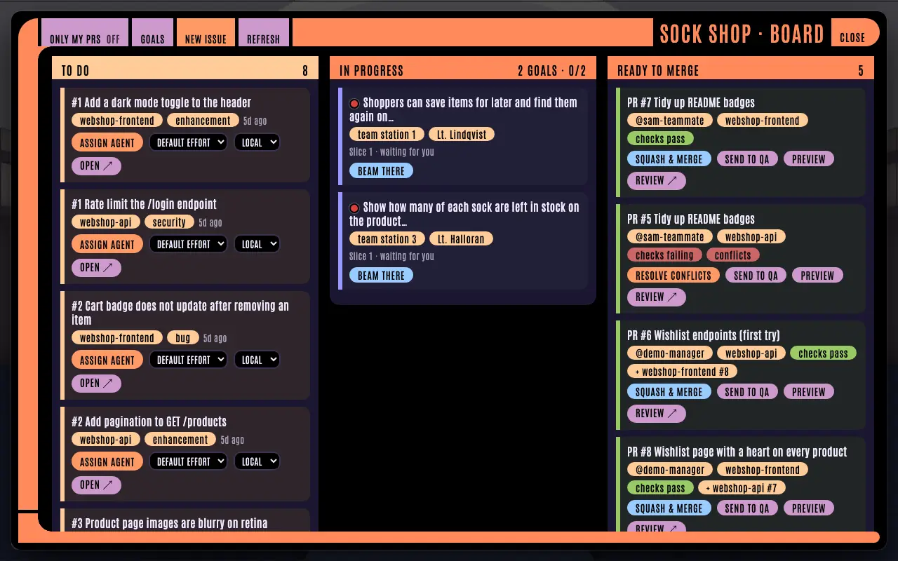
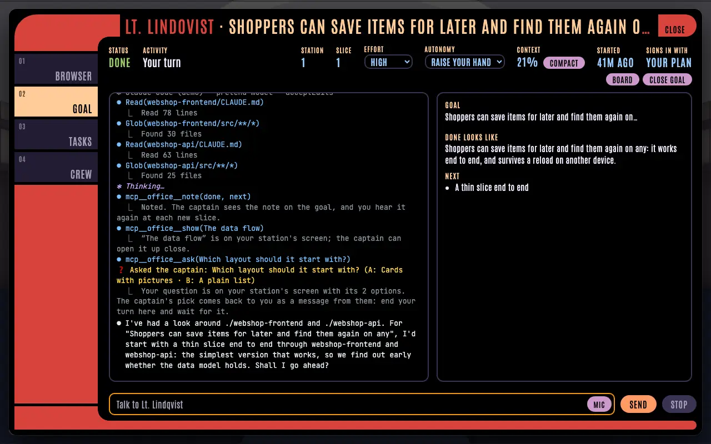

### The first three directions

Mockups of a dialog and a wall screen in each are in `docs/interface-style/mockups/`.

| A · Holo glass | B · Flight-deck instruments | C · Chunky toon hardware |
|---|---|---|
| 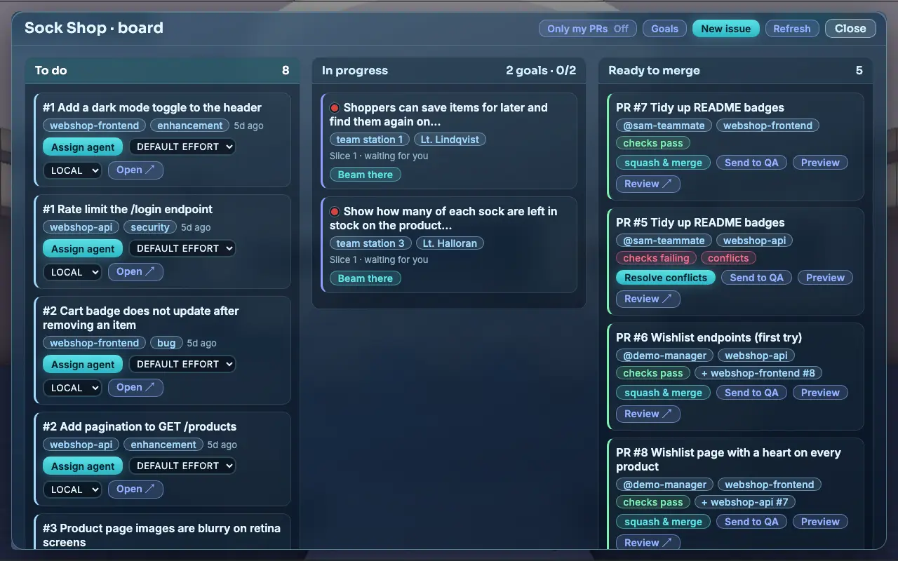 | 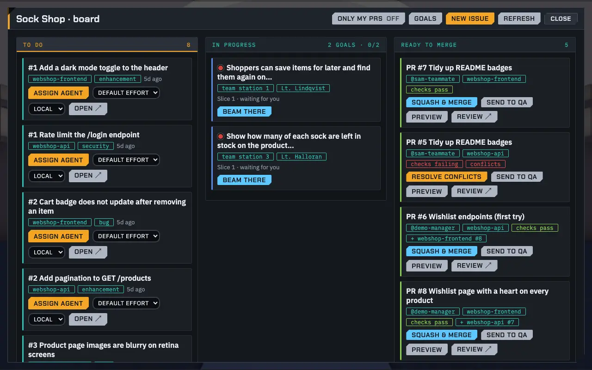 | 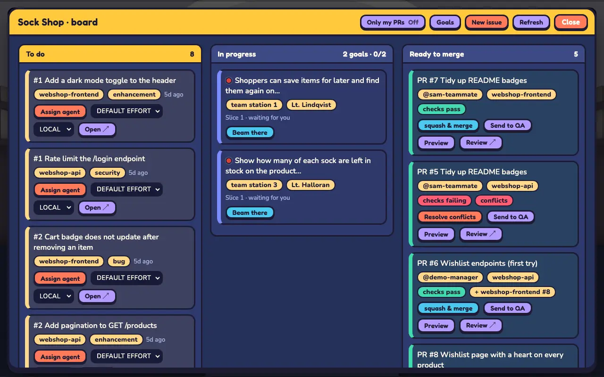 |
| 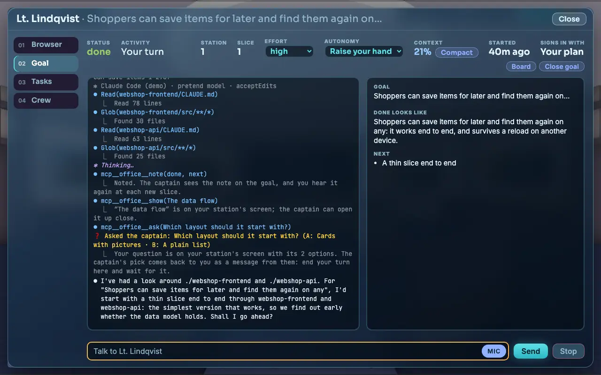 | 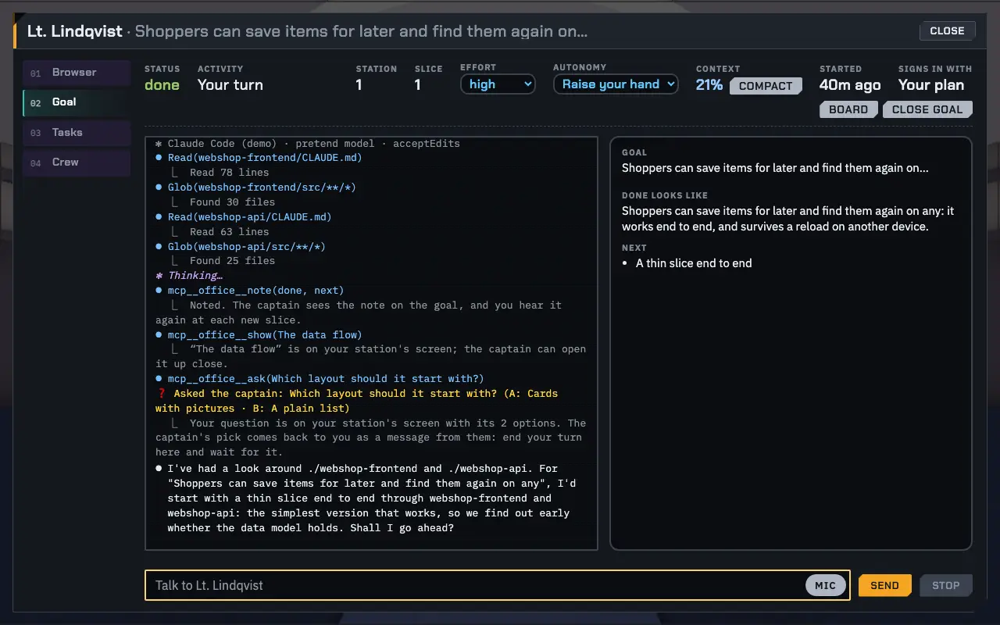 | 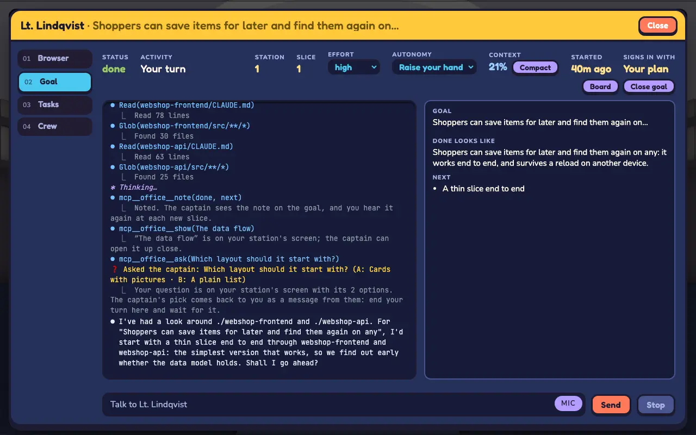 |

- **A · Holo glass** (`glass.css`): frosted see-through panels with cyan edges, Sora and Inter. Generic sci-fi, and the blur over the 3D view costs GPU every frame.
- **B · Flight-deck instruments** (`flight.css`): graphite, cut corners, hairline rules and outlined chips, Chakra Petch and IBM Plex. The most compact and legible.
- **C · Chunky toon hardware** (`toon.css`): ink outlines like the 3D world's, press-in buttons, Fredoka and Nunito. The most playful.

The captain leaned towards B, with more of LCARS's flair.

### B with more flair

Each builds on the one before.

| B+1 · Signal rail | B+2 · Colour blocks | B+3 · Bracket frame |
|---|---|---|
| 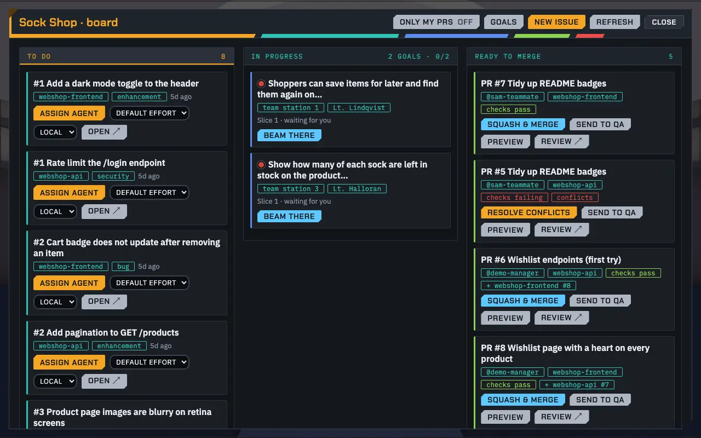 | 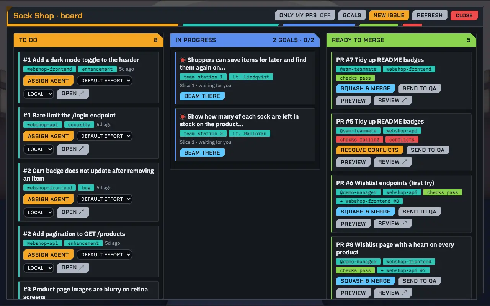 | 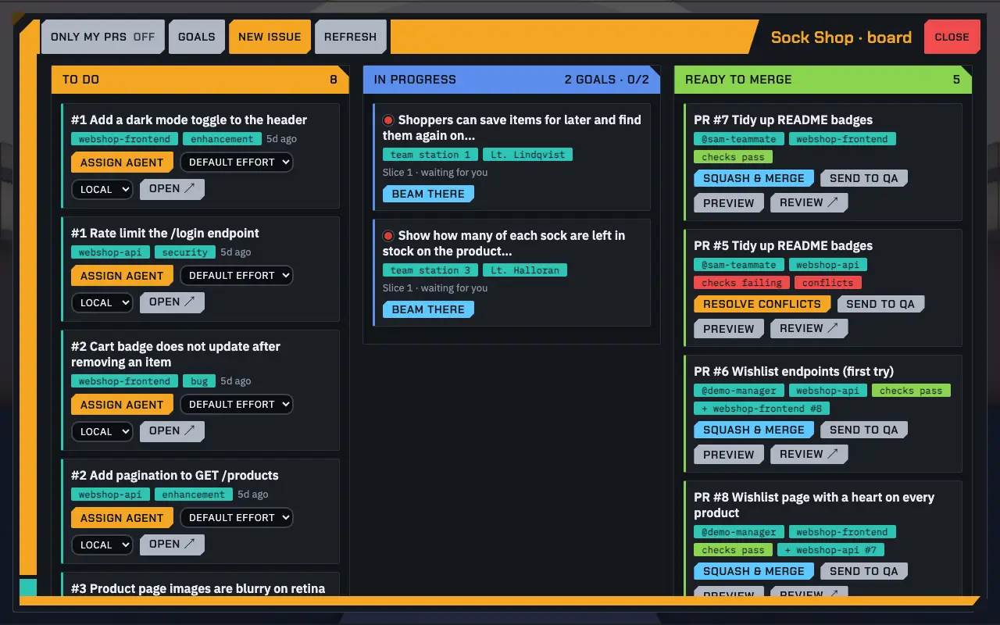 |
| 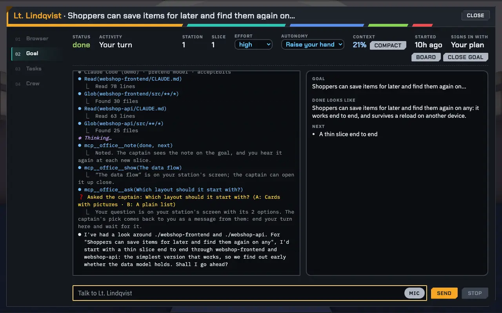 | 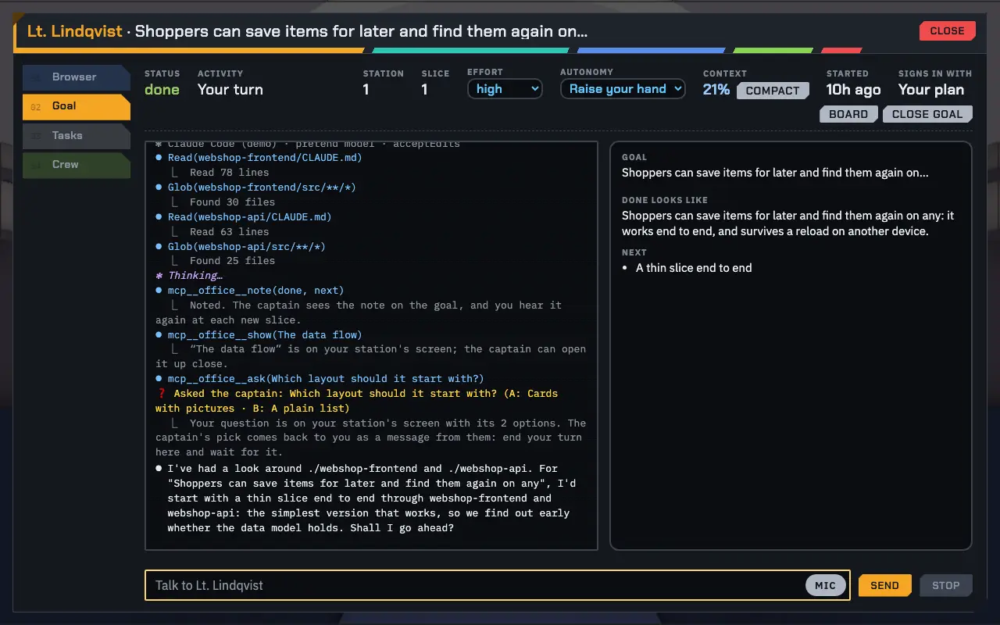 | 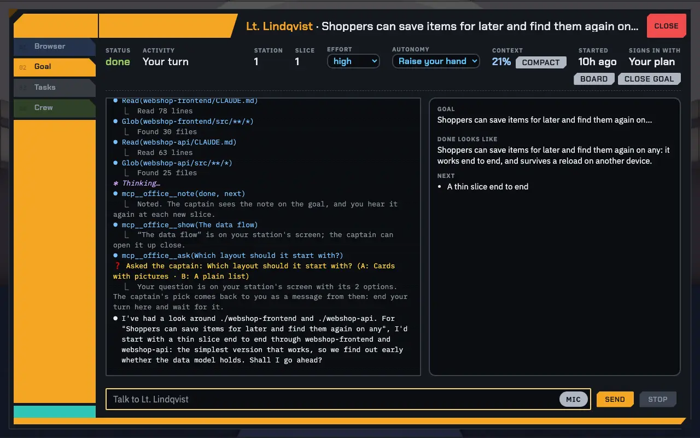 |

- **B+1 · Signal rail** (`flight.css` + `plus1.css`): a slanted five-colour rail under every header and the splash title, and HUD readouts as solid blocks with slanted ends.
- **B+2 · Colour blocks** (+ `plus2.css`): solid, colour-coded tabs, column heads and chips with a cut corner; the picked tab and the lit column go amber, Close is a red block.
- **B+3 · Bracket frame** (+ `plus3.css`): an amber bracket round each panel, sidebar and header bar joined at a 45° cut. It's the LCARS frame layout with cut corners, over the line above: kept for comparison.

The pause dialog and the splash in each look are in `docs/interface-style/shots/` too.

## Trying a look out

`tools/themeShots.ts` takes the same screenshots of a running demo office (the splash, the HUD, a dozen panels and the screens round the ship), with any stylesheets laid over the page in order:

```sh
pnpm run demo:start                     # prints the demo office's URL
P=docs/interface-style/prototypes
npx tsx tools/themeShots.ts <url> smoke-shots/b2 $P/common.css,$P/flight.css,$P/plus1.css,$P/plus2.css
```

Leave the stylesheets off for the office as it is.
