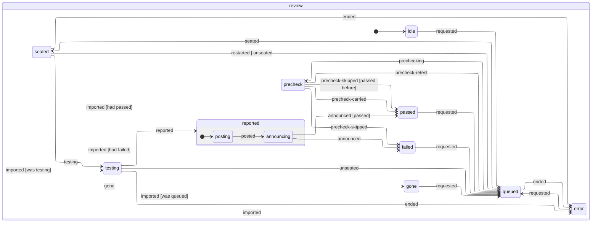

# QA

Every holodeck has a QA officer, and each goal a reviewer of its own.

- **When they test:**
  - Automatically, when Ops opens a PR or pushes new commits to one, once auto-QA is on for the project. A new project starts with it off, so no review runs that you didn't ask for (each is a session of QA's); projects from before it was off keep it on.
    - A lead's ship, a developer's push and Ops' own merge of the base to resolve conflicts each tell QA the commit they pushed (`QaReview.shippedHead`), and the re-test goes from that, not from GitHub's head, which can still be the commit before for a few seconds after a push (it used to put the old verdict back, so the PR showed **QA failed an older commit** and never went back to QA). A lead that ships again while QA is still testing the commit before hears that verdict without spending a turn, marked as being on the earlier commit, and the PR goes straight back to QA for their latest.
  - When a board refresh finds one of Ops' PRs with a head QA has no verdict on, from a push Ops didn't make (CI's Ship workflow committing the decks, you pushing by hand): it goes back to QA at that head, unless someone is fixing it or the operations officer is looking, who hand it back themselves.
  - Whenever you press **Send to QA** (or **Re-test**) on a PR, a teammate's PR included.
- **One at a time, per reviewer:** a goal's pull requests go to the goal's own reviewer, so the holodeck's goals are reviewed side by side. QA goes ahead of new issues in the queue.
- **Which model:** reviewing is lighter work than building, so **Model for QA** lets a cheaper model review while developers and leads stay on the main **Model**. It's stamped on the reviewer each time they sit down to a review.
- **What they do:**
  1. Check the PR's head out in a folder of its own, so a goal's reviewer moving between its slice's repos never checks one PR out over another. When the PR is one of a goal's slice that changed several repos, the slice's other PRs are checked out at their heads beside it: QA tests the PR on its own, then runs the repos together to exercise the slice end to end. The verdict stays on each PR, and a joint check that fails because of a sibling is reported against the sibling, not this PR. Ops hands a slice's PRs to QA only once the lead's ship has opened them all, so the first one reviewed sees the rest.
  2. Read the PR and its linked issues, and work out the acceptance criteria.
  3. Review the diff against the base branch, including whether new tests check what the code does or only run it (tests like that raise coverage but catch nothing).
  4. Run the tests, type checks, linters and build.
  5. Go through every file the diff changes, never a chosen few, and read the changed lines of those no test exercises one by one, asking what would make each wrong. A green suite says nothing about those lines: in [the catch-rate runs](qa-catch.md), every planted bug QA missed was in one.
  6. Click through UI changes with the browser tool.
  7. Hunt the kinds of bug that get past review (restart and shutdown, two things at once, assumptions about git, the API, the SDK or the shell, edge-case input) with probe tests that drive those paths rather than read them, keeping each probe that fails as **proof** (see [Proof](#proof)).
  8. Finish with a structured report: a verdict, every check made, **every changed file** (the tests that exercise it, or none), up to three **spot-checks**, and on a fail the **proofs** and fix instructions.
- **Every file accounted for:** QA's report has to account for each file the pull request changes. A report that leaves some out, says QA only skimmed some, or whose session never opened a changed code file at all, goes back to QA once, in the same session, naming them, and its second report is taken as it is. What QA opened is read from its own tool calls in its transcript, not its say-so. Nearly every review goes back once (QA, left to itself, opens a third of the changed code files or fewer): it roughly triples what a review costs and adds a minute or two. In the catch-rate replay it took QA from 7 to 9 of 10 planted bugs caught. On a big pull request a reviewer otherwise reads the files it judges most relevant and skips the rest, and a bug in a skipped file goes through: [the catch-rate runs](qa-catch.md) found exactly that.
- **The report:** Ops checks QA's proofs, then posts it as a comment on the PR (QA never touches GitHub themselves). Merging a PR whose latest commit QA hasn't passed asks you to confirm, and says why.
- **Spot-checks:** you rarely read a whole diff, so QA picks up to three places in it most worth your own eyes, riskiest first.
- **Screenshots:** Ops commits QA's screenshots to an orphan branch in the PR's repo, `focus-qa-evidence` (no shared history with the code, never merged), and embeds them in the comment.
- **The Playbook:** what QA does on this project, nothing hidden, built from its instructions and settings as they are now (`qaPlaybook` in `server/agents/qa.ts`), so it can't drift from what QA does.
  - **The checks it runs**: per repo, the project's merge checks the repo's package.json has, as commands for its package manager (the same list [the merge check](merging.md) runs), and whether it has a CLAUDE.md, read from the clone Ops keeps; with no clone or no package.json, QA works the checks out itself. A review's step 3 names the same commands, read from QA's checkout of the PR.
  - **Talking to the officer**: say what you want from QA in plain words. The officer answers, and when what you ask means a change, proposes one, shown as a diff. It can change only its switches, how hard it thinks, the scripts it runs and the brief; anything else, its steps included, it says it can't and suggests the nearest thing. It changes nothing itself: **Apply** saves the change as the switches above would, and the Playbook shows it; **Discard** leaves things as they are.
- **Sending a failed PR back:** when QA fails a PR Ops opened, Ops hands QA's summary and fix instructions to the developer who opened it, with each proof test that held, to add to their branch, make pass and keep. A goal's lead hears the same as a note with their next message, as any verdict ([goals](goals.md)): Ops never wakes a lead for one, and only a plugin can (the [chief of staff](../plugins/chief-of-staff/README.md) sends a fail back, twice at most, where send-back's on). If they've gone home, a new agent sits down on the PR's branch, fixes it and pushes to the same PR. The fix goes back to QA by itself, and the re-test is told last round's findings and the commit it tested, so it checks those first, then what changed since, plus a quick smoke test.
  - After 3 failed rounds, or a fix that pushes nothing, the PR is stuck. See [Stuck PRs](#stuck-prs).
  - Teammates' PRs are never sent back. A new project starts with send-back off, so QA's verdict comes to the captain and nothing more runs on its own (each round is a developer's session and another of QA's). Projects from before it was off keep it on.
- **Auto-merge** (off by default, per project): on each board refresh Ops takes every PR it opened one step closer to merged, following `mergeStep` in `shared/mergeGate.ts`.
  - QA passed the PR's current head commit, its checks pass (or it has none) and it merges cleanly: it merges for that exact commit only (`--match-head-commit`), once the [merge check](merging.md) has run the repo's checks on the PR merged onto its base as it is now.
  - Commits arrived after QA's verdict: back to QA first.
  - Checks fail: the failed GitHub Actions runs are re-run once. If they fail again, the PR goes back to its developer with the failing checks, like a QA fail.
  - Conflicts: **Resolve conflicts**, then QA again.
  - A refused merge (the merge check failing, or GitHub requiring reviews, say) shows the reason and isn't retried for that commit.
  - So that a refresh doesn't do the same thing twice, Ops marks a PR's head commit as it acts on it.
  - Teammates' PRs never merge by themselves, and nor do [the climber](../plugins/climber/README.md)'s: the captain merges climbs.
- **Merge when QA passes:** while QA is queued or testing a PR, you can ask for it to merge when QA passes (any PR, a teammate's too, auto-merge on or off). Ops remembers the request with the review and, once QA passes, merges exactly the commit QA passed, once its [merge check](merging.md) passes; if QA fails it, can't finish, or the merge check or GitHub refuses, it tells you and forgets the request. Commits that arrive after the pass go back to QA first. Merging a PR QA failed or hasn't tested still works, after a confirm.
- **Following up:** a message to a reviewer whose turn failed ("Hit a problem – send a message to retry"), or whose PR was asked for again while they waited, picks their conversation back up with the review under test by them again, at the commit they checked out, so the verdict that turn reaches is posted. It used to land on a review that wasn't under test and go nowhere: no comment, the reviewer left **working** and every PR queued for them stuck behind it ([#523](https://github.com/jonhilt/focus/issues/523)). Once their PR has merged or closed, their session is over.

## Proof

QA blocks a pull request only with proof Ops checks itself (`server/agents/qaProof.ts`, tested beside it). In [the bug replay](bug-corpus.md#replaying-qa), QA as it was, failing on its own say-so, caught none of 26 real bugs that had got past it; a review told to hunt with probe tests, and stopped only by a proof test that failed, caught 3, and every change it stopped came with a failing test. That review is now QA's (`HUNTING`, in its instructions on every review).

- **What counts as proof:**
  - **test**: a test file that fails, and the command that runs just it. Usually one of QA's probes, or an existing test the change breaks. Any test runner: the report carries the command. Ops runs it in QA's checkout, without a shell, and only if it names the file (so a whole suite failing for something else can't stand in). It holds when the command fails and its output shows a test failing, and nothing says it never really ran: an import that isn't there, a compile error, no tests found. QA's typo isn't proof.
  - **check**: one of the project's own checks (type check, lint, build) and its command. It holds when Ops' run of it exits with a failure (a missing script doesn't count).
  - **screenshot**: **the one exception**, for what only a browser can show (a broken layout, a blank page, a control that does nothing). It holds only when that screenshot goes on the pull request and the change touches UI code (`touchesUi`), so the captain can see the proof on the PR, and a backend change can't be blocked by a picture. QA is told to prefer a test whenever the logic behind the page can be tested.
- **The verdict** (`provenReport`, `blocksWithProof`): a fail blocks only when at least one proof holds. A fail with none (none named, or none that held) becomes a **pass with advice**, and it's treated as a pass (nobody is sent to fix it, a lead hears it as a pass with QA's advice to take or leave, the captain merges it from the board without confirming), except that auto-merge leaves it for the captain, who reads the advice first. That holds until the [bug replay](bug-corpus.md#replaying-qa) shows how often advice hides a real bug. A pass stays a pass, whatever its proofs. Every comment with proofs says what Ops saw of each.
- **Where it runs:** in QA's own checkout of the PR, after QA's session ends and before anything is posted (`Reviews.proveReport`). A restart in the middle starts that step again with QA's turn. The checkout's untracked files (QA's probes) are cleared at the next round's checkout, so a proof never outlives its review: it lives on only as the test the developer is asked to keep.
- **The switch:** **Block only with proof**, on by default for every project. Off, QA's instructions go back to failing on its own judgement, and its verdict stands as it gave it. It's per project because the rule leans on Ops being able to run the project's tests where QA worked: a project whose tests can't run there (they need a database or a device the checkout hasn't got) would see every fail turn into advice, and is better off with QA's say-so.
- **What it doesn't check:** that a proof fails *because of* the change (a test that also fails on the base branch still holds), and nothing measures yet how this QA does on the corpus: see [the bug corpus](bug-corpus.md#replaying-qa).

## The review journal: picking a review up after a restart

Each pull request's review keeps a journal, `~/.focus/runs/reviews/<owner>__<repo>-<n>.jsonl` (`server/agents/reviewJournal.ts`), like an agent's run journal ([agents](agents.md#the-run-journal-where-a-run-was-and-picking-up-after-a-restart)): numbered facts, each flushed to disk before Ops acts on it (`Store.reviewJournal`), never rewritten. The reviewer's turns are in their own run journal; this one is the review around them, keyed by the PR, since a review outlives its reviewer (QA's next review resets their run). `reported` (the verdict, the report and the comment that says it) is written before anything goes onto GitHub. What they add up to is a state machine's (`reviewMachine`, XState), drawn from its code (a test keeps this picture in step):

<!-- review-machine:start -->

<!-- review-machine:end -->

**The board's review comes from the journal.** What the board shows of a review is what its journal adds up to (`reviewView`): every change it shows is a fact, so `Store.reviews` is rebuilt from the journals when Focus starts, and `state.json` keeps no reviews of its own. A verdict's on the board from `posted`, the moment it's on the pull request, so a crash can't leave a PR the journal has a verdict on showing **QA testing**. A review the board kept before reviews had journals is taken into its journal once, as it was (`imported`). Facts that only change what the board shows aren't arrows in the picture above.

**After a restart** (`Reviews.recover`, before the reviewers' own runs are recovered; `reviewRecovery` decides):

- a review waiting for its reviewer waits again, and one Ops was prechecking goes to QA;
- one whose reviewer was still checking it out (no Claude turn yet) starts again;
- one under test carries on with its reviewer's turn when that picks itself back up: on your plan, in the same conversation, told it was cut off (or held again for your plan's limit). On your API key, or with no conversation to go back to, it ends saying "Interrupted when Focus shut down. Send it to QA again.";
- a verdict QA had reached is posted on the PR if it wasn't yet, and passed on to everyone who hears of one (the board, the ledger, the PR's lead, a send-back), with no Claude turn. A crash in the moment between the comment going up and `posted` being written used to post it twice; now each verdict's comment ends with a hidden mark of its own (`verdictMark`), and a restart looks for it among the pull request's comments before posting. If GitHub can't say, it posts anyway: a verdict said twice beats one lost.
- a PR the operations officer was looking at goes to the captain (it needs you).

Screenshots QA took before the restart are held in memory, so a review that carries on posts only the ones taken after it. While Focus shuts down, nobody new is seated or started.

## Stuck PRs

Before a stuck PR reaches you, the holodeck's operations officer looks at it, in a read-only session, and does exactly one of: **retry QA** (when QA's own session went wrong or the fix has landed since), **send back** to a developer with a note on what to do differently, **re-run checks** (when a red check looks flaky or like an outage), **close the PR** (when the approach can't work: its issue stays open, and the next agent assigned to it hears why), or **escalate** to you with a one-line diagnosis. Only an escalation, or a session that ends without a decision, comes to you. Each PR gets a limited number of triages; past that, it comes straight to you.
