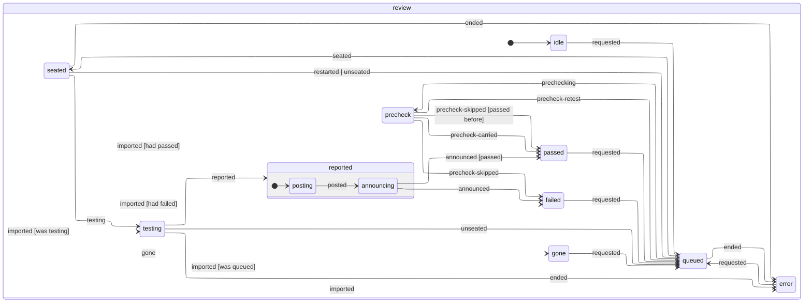

# QA

Every holodeck has a QA officer in blue, sitting at a station in the control ring facing the board, with a display you can look at over their shoulder.

- **When they test:**
  - Automatically, when the office opens a PR or pushes new commits to one. Turn this off per project at the QA station.
    - A lead's ship, a developer's push and the office's own merge of the base to resolve conflicts each tell QA the commit they pushed (`QaReview.shippedHead`), and the re-test goes from that, not from GitHub's head, which can still be the commit before for a few seconds after a push (it used to put the old verdict back, so the PR showed **QA failed an older commit** and never went back to QA). A lead that ships again while QA is still testing the commit before hears that verdict without spending a turn, marked as being on the earlier commit, and the PR goes straight back to QA for their latest (`shippedSinceTested` in `server/agents/retest.ts`).
  - When a board refresh finds one of the office's PRs (a developer's, a plugin brief's or a goal's) with a head QA has no verdict on, from a push the office didn't make (CI's Ship workflow committing the decks, you pushing by hand): it goes back to QA at that head (`verdictBehindHead` in `shared/qa.ts`), unless someone is fixing it or the operations officer is looking, who hand it back themselves.
  - Whenever you press **Send to QA** (or **Re-test**) on a PR on the board, a teammate's PR included.
- **One at a time, per reviewer:** reviews queue up for the holodeck's officer. A goal's pull requests go instead to the goal's own reviewer, who sits at your left hand in the briefing room, across from its lead (and is listed at the QA station), so the holodeck's goals are reviewed side by side. Each goal's reviewer is the same person from review to review, and goes home with the goal; a review they were on, or still waiting for them, goes to the holodeck's officer. QA counts towards **Agents working at once**, but goes ahead of new issues in the queue and doesn't take one of the holodeck's agent slots.
- **How hard they think:** set at the QA station, for the officer and every goal's reviewer alike, from the next review (the model's default to begin with).
- **Which model:** **Model for QA** in the manager's Settings tab, for every room's officer and every goal's reviewer, from their next review: reviewing is lighter work than building, so a cheaper model like `claude-sonnet-5-5` often does while developers and leads stay on the office's **Model**. Empty means the office's **Model**. It's stamped on the reviewer each time they sit down to a review.
- **What they do:**
  1. Check the PR's head out, detached, into a folder of its own inside their workspace (`<reviewer>/<owner>__<repo>-pr<N>/<repo folder>`, laid out like the lead's workspace), so a goal's reviewer moving between its slice's repos never checks one PR out over another, and a re-test keeps its installed dependencies. When the PR is one of a goal's slice that changed several repos, the slice's other PRs are checked out at their heads beside it (`../<their folder>`): QA tests the PR on its own, then runs the repos together to exercise the slice end to end. The verdict stays on each PR, and a joint check that fails because of a sibling is reported against the sibling, not this PR. The office hands a slice's PRs to QA only once the lead's ship has opened them all, so the first one reviewed sees the rest. The folders go when the PR merges or closes. A folder that won't delete (a dev server or install still writing into it) is retried, then moved aside as `trash_…` for the hourly sweep, so it never blocks the next checkout.
  2. Read the PR and its linked issues, and work out the acceptance criteria.
  3. Review the diff against the base branch, including whether new tests check what the code does or only run it (tests like that raise coverage but catch nothing).
  4. Run the tests, type checks, linters and build.
  5. Go through every file the diff changes, never a chosen few, and read the changed lines of those no test exercises one by one (scripts, schemas, prompts and config often aren't, and a coverage report may not reach them), asking what would make each wrong (a comparison off by one, a condition or guard the wrong way round, an argument read from the wrong place, a setting flipped). A green suite says nothing about those lines: in [the catch-rate runs](qa-catch.md), every planted bug QA missed was in one.
  6. Click through UI changes with the browser tool, so you see that on their station's display.
  7. Hunt the kinds of bug that get past review (restart and shutdown, two things at once, assumptions about git, the API, the SDK or the shell, edge-case input) with probe tests that drive those paths rather than read them, keeping each probe that fails as **proof** (see [Proof](#proof)).
  8. Finish with a structured report: a verdict, a summary, every check made, the commands run, **every changed file** (the tests that exercise it, or none, and what they checked there), up to three **spot-checks**, on a fail the **proofs** and fix instructions.
- **Every file accounted for:** the office lists the files the pull request changes in QA's first message (`git diff --name-only` against the base, `WorkspaceOps.changedFiles`), and QA's report has to account for each. A report that leaves some out, or says QA only skimmed or didn't read some (`skimmed`, taking QA at its word), or whose session never opened a changed code file at all, goes back to QA once, in the same session, naming them (`unaccounted` and `filesPrompt` in `server/agents/qa.ts`), and its second report is taken as it is. Nearly every review goes back once (QA, left to itself, opens a third of the changed code files or fewer): it roughly triples what a review costs (about $0.25 to $0.70) and adds a minute or two. In the catch-rate replay it took QA from 7 to 9 of 10 planted bugs caught. What QA opened is read from its own tool calls in its transcript (`openedFiles` and `toolCalls`): a file it read, or a command that printed it whole, counts; a list of files, a grep, or a diff cut short with `head` or `tail` doesn't, and a whole diff of the pull request opens every file. Tests, docs, lock files and pictures needn't be opened (`mustOpen`); in the demo, and for a cloud session, there's no transcript to read, so only the report is checked. On a big pull request a reviewer otherwise reads the files it judges most relevant and skips the rest, and a bug in a skipped file goes through: [the catch-rate runs](qa-catch.md) found exactly that.
- **The report:** the office checks QA's proofs, then posts it as a comment on the PR (QA never touches GitHub themselves), and the board shows **QA passed**, **QA passed with advice** (QA failed it, but no proof held), **QA failed** or, once newer commits land, **QA passed an older commit**. Merging a PR whose latest commit QA hasn't passed asks you to confirm, and says why.
- **Spot-checks:** you rarely read a whole diff, so QA picks up to three places in it most worth your own eyes, riskiest first (a new route or permission, a changed guard, a weakened test, data that could be lost), each with its file, line and what could go wrong there (`SPOT_CHECKS` in `server/agents/qa.ts`). They're listed under **Worth a human look** on the PR comment and in the QA panel, and on a goal's pull requests they go on its chart, where you tick them off. Each links straight to its file and line in the pull request's changed files on GitHub: the office works out GitHub's anchor for it as it reads the report (`diffAnchor`: `diff-`, the SHA-256 of the file's path, then `R` and the line).
- **Files reviewed:** the PR comment ends with QA's account of every changed file (`filesSection` in `server/agents/qa.ts`): a headline of how many changed code files QA's session opened, by its own tool calls rather than its say-so, how many have no test, how many its report left out and how many it was sent back to; then a row per file with whether it was opened (✅, ❌, or – for docs, tests and config it needn't open), the tests QA says exercise it and what it checked. Code no test exercises and QA never opened comes first, since that's where a bug gets through. The table starts folded away above 12 files, and loses its opened column when there's no transcript to read (the demo, a cloud session). The office keeps the account with the review (`QaReview.files`), and the QA panel shows the same table under each report (`filesCovered` in `shared/qa.ts` builds the rows for both), its headline red when a code file went unopened or was left out of the report.
- **Screenshots:** the last 8 screenshots QA takes on purpose (`mcp__browser__screenshot`) go with the report, each with QA's caption. The office commits them to an orphan branch in the PR's repo, `focus-qa-evidence` (created on first use, no shared history with the code, never merged), and embeds them in the comment. A screenshot that fails to upload is left out of the comment and the error shows in QA's terminal.
- **The QA station** (<kbd>E</kbd> on the officer when they're free, or the QA chip on a PR):
  - **Reports**: every report in full, with its screenshots;
  - **Settings**: the auto-QA, send-back, **block only with proof** and auto-merge switches, how hard QA thinks, and the project's **QA brief**: what to check on every PR of this project ("works at phone width", "no console errors"). It goes into the officer's instructions on every review.
- **Sending a failed PR back:** when QA fails a PR the office opened, the office hands QA's summary and fix instructions to the developer who opened it, with each proof test that held: its file, how it failed and its source, to add to their branch (named as the repo names its tests, without `.proof`), make pass and keep (`proofsToKeep` in `server/agents/qaProof.ts`). A goal's lead hears the same. If they've gone home, a new agent sits down on the PR's branch, fixes it and pushes to the same PR. The fix goes back to QA by itself, and the re-test is told last round's findings (its summary, every failed or skipped check with its details, and the fix instructions) and the commit it tested, so it checks those first, then what changed since, plus a quick smoke test.
  - After 3 failed rounds, or a fix that pushes nothing, the PR is stuck. See [Stuck PRs](#stuck-prs).
  - Teammates' PRs are never sent back. A new project starts with send-back off, so QA's verdict comes to the captain and nothing more runs on its own (each round is a developer's session and another of QA's); switch it on per project at the QA station. Projects from before it was off keep it on.
- **Auto-merge** (off by default; switch it on per project at the QA station or on the project's card in the ready room): on each board refresh the office takes every PR it opened one step closer to merged, following `mergeStep` in `shared/mergeGate.ts`.
  - QA passed the PR's current head commit, its checks pass (or it has none) and it merges cleanly: it merges with the repo's merge method ([Configuration → Merge method](configuration.md#merge-method)), for that exact commit only (`--match-head-commit`), and its developer packs up. First the [merge check](merging.md) runs the repo's checks on the PR merged onto its base as it is now. That happens in the background, and the next refresh picks the PR up again.
  - Commits arrived after QA's verdict: back to QA first.
  - Checks fail: the failed GitHub Actions runs are re-run once (`gh run rerun --failed`). If they fail again, the PR goes back to its developer with the failing checks' names and links, like a QA fail.
  - Conflicts: **Resolve conflicts**, then QA again.
  - A refused merge (the merge check failing, or GitHub requiring reviews, say) shows the reason and isn't retried for that commit.
  - So that a refresh doesn't do the same thing twice, the office marks a PR's head commit as it re-runs its checks, sends it back or resolves its conflicts, and when GitHub refuses it (`stepMark`). The marks are kept in memory, and a PR's mark is forgotten once the PR leaves the board, unless its repo couldn't be listed that time (`forgottenMarks`).
  - Teammates' PRs never merge by themselves, and nor do [the climber](../plugins/climber/README.md)'s: the captain merges climbs.
- **Merge when QA passes:** while QA is queued or testing a PR, its merge button becomes **Merge when QA passes** (any PR, a teammate's too, auto-merge on or off). The office remembers the request with the review and, once QA passes, merges exactly the commit QA passed (`requestedMerge` in `shared/mergeGate.ts`), once its [merge check](merging.md) passes; if QA fails it, can't finish, or the merge check or GitHub refuses, it tells you and forgets the request. Commits that arrive after the pass go back to QA first. Press the button again to take the request back. Merging a PR QA failed or hasn't tested still works, after a confirm.
- **Following up:** message the QA officer like any agent, to have them look at something else. A message to a reviewer whose turn failed ("Hit a problem – send a message to retry"), or whose PR was asked for again while they waited, picks their conversation back up with the review under test by them again, at the commit they checked out (`resumedFacts` in `server/agents/reviewJournal.ts`), so the verdict that turn reaches is posted. It used to land on a review that wasn't under test and go nowhere: no comment, the reviewer left **working** and every PR queued for them stuck behind it ([#523](https://github.com/jonhilt/focus/issues/523)). Once their PR has merged or closed, their session is over: a message gets "PR #n was merged; nothing to review" instead of resuming it.

## Proof

QA blocks a pull request only with proof the office checks itself (`server/agents/qaProof.ts`, tested beside it). In [the bug replay](bug-corpus.md#replaying-qa), QA as it was, failing on its own say-so, caught none of 26 real bugs that had got past it; a review told to hunt with probe tests, and stopped only by a proof test that failed, caught 3, and every change it stopped came with a failing test. That review is now QA's (`HUNTING`, in its instructions on every review).

- **What counts as proof** (the report's `proofs`, at most 5):
  - **test**: a test file that fails, and the command that runs just it from the repo's root. Usually one of QA's probes, named as the repo names its tests with `.proof` before the suffix (`queue.proof.test.ts`, `test_queue_proof.py`), or an existing test the change breaks. Any test runner: the report carries the command. The office reads the file in QA's checkout (it must be there), runs the command there, without a shell (`commandArgs`: no pipes, `&&`, redirects or `$`) and only if it names the file (so a whole suite failing for something else can't stand in), with a 10 minute limit. It holds when the command fails and its output shows a test failing (an assertion, or a runner's count of failures), and nothing says it never really ran: an import that isn't there, a compile error, no tests found (`proofOutcome`). QA's typo isn't proof.
  - **check**: one of the project's own checks (type check, lint, build) and its command. It holds when the office's run of it exits with a failure (a missing script doesn't count).
  - **screenshot**: **the one exception**, for what only a browser can show (a broken layout, a blank page, a control that does nothing). It names one of the screenshots QA took, and holds only when that screenshot is one that goes on the pull request (the last 8) and the change touches UI code (`.tsx`, `.vue`, `.css`, `.html`…, or a `client/`, `web/`, `ui/`, `components/`, `pages/`… folder: `touchesUi`). So the captain can see the proof on the PR, and a backend change can't be blocked by a picture. QA is told to prefer a test whenever the logic behind the page can be tested.
- **The verdict** (`provenReport`, `blocksWithProof`): a fail blocks only when at least one proof holds. A fail with none (none named, or none that held) becomes a **pass with advice**: the PR comment is headed **✅ Passed with advice**, says why, and lists QA's fix instructions under **💡 Advice (not proved)**; the board shows **QA passed with advice**, and it's treated as a pass (nobody is sent to fix it, a lead hears it as a pass with QA's advice to take or leave, the captain merges it from the board without confirming), except that auto-merge leaves it for the captain, who reads the advice first. That holds until the [bug replay](bug-corpus.md#replaying-qa) shows how often advice hides a real bug. A pass stays a pass, whatever its proofs. Every comment with proofs has a **🧪 Proof** table: each finding, its proof and what the office saw (fails, passed when the office ran it, or not proof and why), and the QA panel shows the same.
- **Where it runs:** in QA's own checkout of the PR, after QA's session ends and before anything is posted (`Reviews.proveReport`); QA's terminal shows each proof's outcome. A restart in the middle starts that step again with QA's turn. The checkout's untracked files (QA's probes) are cleared at the next round's checkout, so a proof never outlives its review: it lives on only as the test the developer is asked to keep.
- **The switch:** **Block only with proof** at the QA station, on by default for every project. Off, QA's instructions go back to failing on its own judgement, and its verdict stands as it gave it. It's per project because the rule leans on the office being able to run the project's tests where QA worked: a project whose tests can't run there (they need a database or a device the checkout hasn't got) would see every fail turn into advice, and is better off with QA's say-so.
- **What it doesn't check:** that a proof fails *because of* the change (a test that also fails on the base branch still holds), and nothing measures yet how this QA does on the corpus: see [the bug corpus](bug-corpus.md#replaying-qa).

## The review journal: picking a review up after a restart

Each pull request's review keeps a journal, `~/.focus/runs/reviews/<owner>__<repo>-<n>.jsonl` (`server/agents/reviewJournal.ts`), like an agent's run journal ([agents](agents.md#the-run-journal-where-a-run-was-and-picking-up-after-a-restart)): numbered facts, each flushed to disk before the office acts on it (`Store.reviewJournal`), never rewritten. The reviewer's turns are in their own run journal; this one is the review around them, keyed by the PR, since a review outlives its reviewer (QA's next review resets their run). Its facts are `requested` (the room, the PR and its title, a lead's shipped commit, why the operations officer sent it back), `prechecking` and how the precheck went (`precheck-skipped`, `precheck-carried`, `precheck-retest`), `seated`, `testing` (the commit), `reported` (the verdict, the report and the comment that says it, written before anything goes onto GitHub), `posted` (the comment's link), `announced` (once the ledger, the PR's lead and any send-back have heard), `ended` without a verdict, `unseated` (its reviewer went home with their goal), and `gone` when the PR merges or closes (a reopened PR can be asked for again). What they add up to is a state machine's (`reviewMachine`, XState), drawn from its code (a test keeps this picture in step):

<!-- review-machine:start -->

<!-- review-machine:end -->

**The board's review comes from the journal.** What the board shows of a review (QA queued, testing, passed or failed, the report and its comment, failed rounds, a merge asked for, what the office is doing about a failed PR) is what its journal adds up to (`reviewView`): every change it shows is a fact, so `Store.reviews` is rebuilt from the journals when the office starts and follows each fact after, and `state.json` keeps no reviews of its own. Besides the review's own steps, that's `head-shipped` (a lead shipped while QA was at it), `merge-requested`, `follow-up` (a developer fixing it, or it needs you), and the operations officer's `triaging`, `triage-activity` and `triaged`. A verdict's on the board from `posted`, the moment it's on the pull request, so a crash can't leave a PR the journal has a verdict on showing **QA testing**. A review the board kept before reviews had journals is taken into its journal once, as it was (`imported`). Facts that only change what the board shows aren't arrows in the picture above: they don't move the review from one phase to another.

**After a restart** (`Reviews.recover`, before the reviewers' own runs are recovered; `reviewRecovery` decides):

- a review waiting for its reviewer waits again, and one the office was prechecking goes to QA;
- one whose reviewer was still checking it out (no Claude turn yet) starts again;
- one under test carries on with its reviewer's turn when that picks itself back up: on your plan, in the same conversation, told it was cut off (or held again for your plan's limit). On your API key, or with no conversation to go back to, it ends saying "Interrupted when Focus shut down. Send it to QA again.";
- a verdict QA had reached is posted on the PR if it wasn't yet, and passed on to everyone who hears of one (the board, the ledger, the PR's lead, a send-back), with no Claude turn. A crash in the moment between the comment going up and `posted` being written used to post it twice; now each verdict's comment ends with a hidden mark of its own (`verdictMark`), and a restart looks for it among the pull request's comments before posting. If GitHub can't say, it posts anyway: a verdict said twice beats one lost.

- a PR the operations officer was looking at goes to the captain (it needs you).

Screenshots QA took before the restart are held in memory, so a review that carries on posts only the ones taken after it. While the office shuts down, nobody new is seated or started.

## Stuck PRs

Before a stuck PR reaches you, the holodeck's operations officer (the one at the **Ops** station) looks at it. The PR card says **Lt. … is looking**, and so does their speech bubble.

- **What they read:** QA's last two reports, GitHub's checks, the diff, the linked issue and a checkout of the PR. It's the same kind of read-only session as their drafting (`Read`, `Glob`, `Grep`, `dontAsk`).
- **What they do, exactly one of:**
  - **retry QA**, when QA's own session went wrong or the fix has landed since. QA gets their note.
  - **send back** to a developer, with a note on what to do differently.
  - **re-run checks**, when a red GitHub check looks flaky or like an outage. The failed Actions jobs re-run, then QA tests again.
  - **close the PR**, when the approach can't work. Its issue stays open and the board marks it (**PR #… closed**). The next agent assigned to it hears why.
  - **escalate** to you, with a one-line diagnosis.
- Afterwards the card says what they did. Only an escalation, or a session that ends without a decision, shows **QA failed: needs you** with a toast.
- **Limit:** each PR gets 2 triages. If it gets stuck a third time, it comes straight to you.
